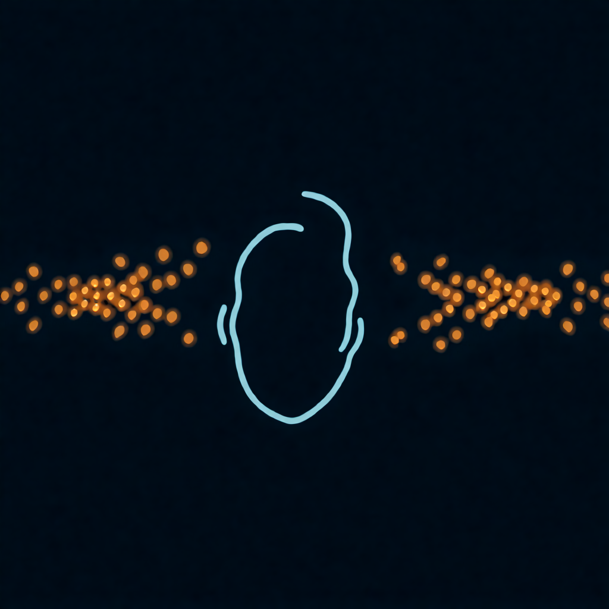

## Часть 2. Параметры вглубь

В этой части каждый параметр разобран отдельно, без привязки к программе. Названия ручек у разных производителей разные, поэтому для каждого параметра дан список имён, под которыми его ищут в интерфейсах. В части 3 эти же параметры найдём в Serum 2, Granulator III и Pigments.

### Глава 4. Источник и позиция


#### Источник

Гранулятор ничего не придумывает сам: всё, что он играет, лежит в исходном файле. Плохой исходник через гранулятор не станет хорошим, зато хороший раскроется десятком сторон.

Что делает звук хорошим источником:

- **Богатый спектр.** Звон, голос, струна, шум улицы дают зёрнам много материала. Чистый синус даст скучный синус.
- **Изменение во времени.** Если звук по ходу меняется, каждая позиция в файле звучит по-своему, и движение позиции становится музыкой. У ложки так и есть: стук, звон, хвост.
- **Чистая запись.** Перегруз и цифровые щелчки гранулятор размножит сотнями копий.
- **Без лишней тишины.** Зерно, взятое из тишины, звучит тишиной. Облако начнёт проваливаться в дыры.

Стерео или моно? Стерео исходник даёт зёрнам свою ширину, моно оставляет её на откуп ручке панорамы (глава 8). Начинай с моно, так понятнее, что делает каждая ручка.

#### Позиция

Позиция говорит, из какого места файла взять следующее зерно. Это главная ручка гранулятора, потому что она управляет временем.

**Как называется в интерфейсах:** Position, Pos, Start, Scan, Playhead, Offset.

Позицию задают в процентах от длины файла, в миллисекундах или курсором прямо на картинке волны. Двигать её можно тремя способами.

**Стоять на месте (заморозка).** Позиция не двигается, все зёрна берутся из одной точки. Звук в этой точке тянется бесконечно. Лучше всего замораживаются устойчивые места: гласная в голосе, середина звона, ровная нота струны. Атака замораживается хуже: зёрна из стука дадут жужжание, похожее на мотор.

**Двигать вручную.** Крутишь ручку, и проходишь по файлу с любой скоростью, вперёд и назад. Звук становится инструментом, на котором ты играешь временем.

**Двигать автоматически (скан).** Позиция сама едет по файлу с заданной скоростью. Скорость 100% значит исходный темп. 50% значит вдвое медленнее, 0% значит заморозка, отрицательная скорость значит назад.

```math
T_{\text{new}} = \frac{T_{\text{source}}}{s}
```

Здесь s это скорость скана (1 = 100%), T это длительность. Ложка в 3 секунды на скорости 1% звучит 300 секунд, то есть 5 минут, на той же высоте.

#### Окно чтения

Многие грануляторы позволяют ограничить кусок файла, по которому ходит позиция: начало и конец, иногда с петлёй. Звук ложки можно запереть в зоне звона и выбросить стук.

**Как называется:** Start/End, Loop, Region, Window, Range.

#### Разброс позиции

Разброс говорит, насколько далеко от позиции может отскочить каждое зерно. При разбросе 0 все зёрна берутся из одной точки. При 20 мс каждое зерно берётся случайно где-то в пределах 20 мс от неё.

**Как называется:** Spray, Jitter, Scatter, Random Position, Pos Rand, Variation.

| Разброс | Что слышно |
| --- | --- |
| 0 | чистая заморозка, может звучать «машинно», с призвуком гудения |
| 5–30 мс | звук оживает, гудение уходит, появляется мягкий хорус |
| 50–300 мс | исходник смазывается, рождается облако |
| весь файл | мозаика: зёрна из стука, звона и хвоста вперемешку |

Это первая ручка, которую стоит поднять, если замороженный звук кажется механическим.

> **Под капотом.** Гудение при нулевом разбросе возникает потому, что все зёрна одинаковые: поток идентичных зёрен становится периодическим сигналом, и частота зёрен вылезает отдельным тоном (глава 2). Разброс позиции делает соседние зёрна разными и разрушает эту периодичность. По сути это декорреляция, тот же приём, на котором строится хорус.

#### Живой вход

Часть грануляторов умеет брать зёрна из звука, который идёт прямо сейчас: с микрофона, гитары, соседней дорожки. Звук пишется в короткий кольцевой буфер, и позиция ходит уже по нему. Так гранулятор становится эффектом. Какие из трёх наших инструментов это умеют, разберём в части 3.

#### Упражнение 4.1. Три точки ложки

1. Загрузи ложку в любой гранулятор. Скан на 0, разброс на 0.
2. Поставь позицию на стук. Послушай жужжание.
3. Поставь позицию в середину звона. Послушай ровный тон.
4. Поставь позицию в хвост, где почти тишина. Тихий шелест и провалы.
5. Вернись в звон и медленно поднимай разброс от 0 до максимума. Запомни точку, где тон превращается в облако.

*Иллюстрация 4.1. Позиция и разброс позиции.*

### Глава 5. Размер зерна и огибающая


#### Размер

Размер говорит, сколько длится каждое зерно. Это вторая главная ручка после позиции, и она решает, узнаешь ли ты исходник.

**Как называется:** Size, Length, Duration, Grain Size, Window Size.

Задают размер тремя способами, и полезно понимать, какой из них стоит в твоём инструменте:

- **В миллисекундах.** Самый частый вариант. 50 мс остаются 50 мс на любой ноте.
- **В долях такта.** Размер привязан к темпу проекта: 1/16, 1/32. Удобно для ритмичных нарезок.
- **Относительно высоты.** Размер считается в периодах звучащей ноты, и на высоких нотах зёрна сами становятся короче. Так устроены движки, где зёрна дают тон (глава 6).

Что происходит, когда крутишь размер вниз от 500 мс до 1 мс:

1. **500–100 мс.** Слышны куски исходника, ложка узнаётся целиком, с атакой.
2. **100–30 мс.** Атака размывается, остаётся тон и окраска. Зона красивых пэдов.
3. **30–10 мс.** Исходник едва узнаётся, звук становится зернистым и шершавым.
4. **10–1 мс.** Тембр исходника пропадает, остаются щелчки, жужжание, шипение. В синхронном потоке тут рождаются новые тембры.

Размер и плотность работают в паре (формула перекрытия в главе 2). Уменьшил размер, не трогая плотность, и облако поредело, появились дыры. Чтобы сохранить гладкость, при коротких зёрнах поднимай плотность.

> **Под капотом.** Короткое зерно звучит шире длинного из-за соотношения неопределённости: длительность сигнала и ширина его спектра обратно пропорциональны. Зерно в 2 мс, вырезанное из чистого тона 440 Гц, содержит меньше одного периода этого тона, и спектр размазывается на тысячи герц. Зерно в 100 мс содержит 44 периода, и спектр остаётся узким пиком на 440 Гц.

#### Огибающая зерна

Огибающая решает, как громкость зерна меняется от начала до конца. Ты уже знаешь, зачем она нужна: убрать щелчки. Но форма огибающей заодно сильно влияет на звук.

**Как называется:** Window, Envelope, Shape, Grain Env, Smoothness, Contour.

| Форма | Как выглядит | Как звучит |
| --- | --- | --- |
| Колокол (Hann) | плавный подъём, плавный спад | мягко, без щелчков; рабочая форма по умолчанию |
| Гаусс | колокол уже и с длинными хвостами | ещё мягче, но слышна меньшая часть зерна; звук туманнее |
| Трапеция (Tukey) | быстрый подъём, ровная полка, быстрый спад | больше исходника, ярче и разборчивее; на коротких зёрнах может цокать |
| Треугольник | прямой подъём, прямой спад | между колоколом и трапецией, чуть жёстче колокола |
| Перкуссия | мгновенная атака, долгий спад | каждое зерно как маленький щипок: капли, стеклянные звоны, плаки |
| Обратная перкуссия | долгий подъём, мгновенный обрыв | зёрна всасываются, звук как запись задом наперёд |
| Прямоугольник | нет подъёма и спада | щелчки на каждом зерне, жёсткий цифровой треск, глитч |

Часто вместо выбора формы дают одну или две ручки:

- **Сглаживание (Smooth).** Двигает форму от прямоугольника к колоколу. Ноль значит треск, максимум значит мягкость.
- **Перекос (Skew, Tilt, Attack/Decay).** Сдвигает пик огибающей к началу или к концу зерна. Пик в начале даёт перкуссию, пик в конце даёт обратную перкуссию.

> **Под капотом.** Окно умножается на зерно, а умножение во времени это свёртка в спектре: спектр окна размазывает спектр исходника. У окон с плавными краями (Hann, Гаусс) главный лепесток чуть шире, зато боковые лепестки на десятки децибел ниже, поэтому они добавляют мало шума. Прямоугольное окно даёт высокие боковые лепестки, отсюда треск. Трапеция стоит посередине: полка пропускает больше исходника, но крутые края поднимают боковые лепестки.

#### Упражнение 5.1. Форма решает

1. Ложка, позиция в звон, разброс 10 мс, плотность средняя.
2. Размер 80 мс. Переключи все доступные формы огибающей и запиши для себя по одному слову на каждую.
3. Размер 5 мс. Повтори. Заметь, что на коротких зёрнах разница между формами слышна сильнее.
4. Найди перкуссионную форму, поставь плотность пониже. Ложка рассыпалась на капли.

*Иллюстрация 5.1. Формы окна зерна.*

### Глава 6. Плотность и синхронность


#### Плотность

Плотность говорит, сколько зёрен рождается за секунду на одну ноту. Это ручка, которая превращает дробь в облако.

**Как называется:** Density, Rate, Grains, Frequency, Grain Rate, Spawn Rate, Interval. Если ручка называется Interval или Period, она работает наоборот: задаёт паузу между зёрнами в миллисекундах, и чем больше число, тем реже зёрна.

Три способа задать плотность:

- **Зёрен в секунду, в герцах.** 10 Гц значит 10 зёрен в секунду.
- **В долях такта.** 1/16 значит зерно на каждую шестнадцатую. Зёрна попадают в сетку, гранулятор становится ритм-машиной.
- **От высоты ноты.** Частота зёрен следует за клавиатурой, и зёрна сами дают тон (ниже).

Что слышно по мере роста плотности, при размере зерна 50 мс:

| Плотность | Перекрытие | Что слышно |
| --- | --- | --- |
| 2–8 зёрен/с | 0,1–0,4 | отдельные капли, пуантилизм, редкий дождь |
| 10–20 | 0,5–1 | дробь, тремоло, зёрна почти встык |
| 30–100 | 1,5–5 | гладкое облако, хорус |
| 100 и выше | больше 5 | плотная стена, исходник размыт, звук похож на шум с окраской |

#### Громкость растёт вместе с плотностью

Чем больше зёрен звучит разом, тем громче облако. Удвоил плотность, и уровень вырос примерно на 3 дБ, если зёрна разные. Если зёрна одинаковые и совпадают по фазе, рост будет 6 дБ. Поэтому, поднимая плотность, следи за выходом и убавляй громкость. Некоторые грануляторы компенсируют это сами.

> **Под капотом.** Некоррелированные сигналы складываются по мощности: N зёрен дают амплитуду, пропорциональную корню из N, то есть +3 дБ на каждое удвоение. Коррелированные складываются по амплитуде: N зёрен дают амплитуду в N раз больше, +6 дБ на удвоение. Разброс позиции и высоты как раз декоррелирует зёрна и спасает от резких скачков громкости.

#### Синхронность

Глава 2 ввела три режима потока: синхронный, асинхронный и почти синхронный. В интерфейсах между ними обычно переключают одной ручкой.

**Как называется:** Sync, Async, Random Rate, Rate Jitter, Spray (во времени), Irregularity, Chaos.

- **Разброс времени 0.** Зёрна идут как метроном. Выше 20 зёрен в секунду рождается тон.
- **Разброс времени средний.** Тон шершавый, живой, как хор или смычок.
- **Разброс времени максимальный.** Тона нет, есть облако, шорох, рой.

#### Зёрна как генератор ноты

Самый неожиданный приём гранулярного синтеза. Свяжи плотность с клавиатурой: нажал ля первой октавы, и зёрна идут 440 раз в секунду, синхронно. Теперь гранулятор играет нотами, хотя позиция стоит на месте и высоту зерна ты не трогал.

Внутренность зерна при этом решает тембр. Зерно из звона ложки даст металлическую ноту, зерно из гласной «а» даст ноту с окраской «а». Так из записанного голоса собирается синтетический хор, а из стука по столу собирается бас.

В таком режиме у звука две высоты сразу. Одну задаёт частота зёрен, это нота. Вторую задаёт высота внутри зерна (глава 7), это окраска, форманта. Двигаешь высоту зерна, и нота стоит, а тембр «открывается» и «закрывается», как рот при пении.

> **Под капотом.** Этот принцип лежит в основе FOF-синтеза и пульсарного синтеза. Частота следования зёрен r задаёт основной тон. Длительность зерна и его содержимое задают спектральную огибающую: где спектр поднимается, там форманта. Если размер зерна больше периода 1/r, зёрна перекрываются и форманты становятся уже; если меньше, между зёрнами тишина, и спектр становится шире и «пульсарнее».

#### Упражнение 6.1. Дождь и нота

1. Ложка, позиция в звон, размер 30 мс, разброс позиции 10 мс.
2. Плотность 3 зерна в секунду, асинхронно. Редкие капли.
3. Плавно поднимай плотность до 200. Отметь, где капли слились в облако.
4. Убери разброс времени в ноль. Подними плотность за 100. Услышь, как облако загудело тоном.
5. Если в инструменте плотность можно связать с клавиатурой, сыграй гамму. Ты играешь ложкой мелодию, а позиция всё это время стоит на месте.

*Иллюстрация 6.1. Плотность: от капель к облаку.*

### Глава 7. Высота, направление и разброс высоты


#### Высота зерна

Высота зерна решает, с какой скоростью гранулятор читает звук внутри каждого зерна. Читает вдвое быстрее, и зерно звучит на октаву выше. Вдвое медленнее, и на октаву ниже. Главное: на позицию это никак не влияет, время по файлу идёт как шло.

**Как называется:** Pitch, Tune, Transpose, Grain Pitch, Coarse/Fine, Semi/Cent.

Обычно высоту задают двумя ручками: грубой в полутонах и точной в центах (сотых долях полутона). Плюс клавиатура: в синтезаторе нажатая нота транспонирует зёрна относительно базовой ноты, как в сэмплере.

Важная деталь. Когда высота меняется скоростью чтения, вместе с нотой едет и тембр. Ложка на две октавы ниже звучит как колокол собора, на две октавы выше как стеклянная пыль. Голос на октаву выше превращается в бурундука, хотя длина звука не изменилась. Это свойство легко превратить в инструмент: высота зерна работает как ручка «размера» источника.

> **Под капотом.** Смена скорости чтения в k раз умножает все частоты внутри зерна на k, включая форманты. Некоторые движки умеют сдвигать высоту с сохранением формант, но это уже спектральная обработка поверх гранулярной. А в синхронном режиме из главы 6 всё наоборот: ноту задаёт частота зёрен, а высота зерна двигает только форманты.

#### Разброс высоты

Разброс высоты даёт каждому зерну случайное отклонение от основной ноты. Это одна из самых красивых ручек гранулятора.

**Как называется:** Pitch Spread, Pitch Random, Pitch Jitter, Detune, Pitch Scatter.

| Разброс | Что слышно |
| --- | --- |
| 1–10 центов | лёгкий хорус, звук шире и теплее |
| 10–50 центов | плывущая, «пьяная» расстройка, звук как из старой плёнки |
| несколько полутонов | облако из соседних нот, кластер, туман |
| октавы | зёрна прыгают по регистрам, мерцание |

У многих грануляторов разброс можно привязать к интервалам. Тогда каждое зерно берёт высоту только из заданного набора: октавы, квинты, ноты лада.

- **Только октавы.** Звук мерцает, как блики на воде, но остаётся на одной ноте. Классический приём для эмбиента.
- **Октавы и квинты.** Мерцающий органный аккорд.
- **Ноты лада.** Каждое зерно играет случайную ноту гаммы, и одна нажатая клавиша рождает облако-аккорд.

#### Направление

Зерно можно читать задом наперёд. Короткое обратное зерно на слух почти неотличимо от прямого, а вот на зёрнах длиннее 50 мс атаки разворачиваются и звук начинает «всасываться».

**Как называется:** Reverse, Direction, Rev Prob, Backwards.

Часто дают вероятность: 0% значит все зёрна прямые, 100% значит все обратные, 50% значит вперемешку. Смесь даёт зыбкий, неустойчивый звук, будто время шатается.

#### Скольжение внутри зерна

В некоторых движках высоту можно менять прямо внутри зерна: каждое начинается на одной ноте и съезжает к другой. Короткие зёрна с падающей высотой звучат как капли или лазерные «пиу», длинные звучат как стоны. Если в твоём инструменте такой ручки нет, ничего страшного: похожий эффект даёт быстрая модуляция высоты (глава 9).

#### Упражнение 7.1. Аккорд из одной ложки

1. Ложка, позиция в звон, размер 100 мс, плотность 40, разброс позиции 20 мс.
2. Сыграй ноту до. Звон стал на эту ноту.
3. Опусти высоту на −24 полутона. Ложка стала колоколом.
4. Верни высоту. Дай разброс высоты 15 центов. Звук стал шире.
5. Если есть привязка разброса к интервалам, выбери октавы и подними разброс до ±1 октавы. Мерцание.
6. Поставь вероятность реверса на 50%. Послушай, как зыбко стало.

*Иллюстрация 7.1. Разброс высоты по октавам.*

### Глава 8. Пространство, случайность и голоса



#### Панорама зёрен

Каждое зерно можно поставить в своё место стереопанорамы. Пока все зёрна звучат по центру, облако узкое, как из одного динамика. Разбросай их, и облако разольётся по всей ширине, а в наушниках зёрна начнут проноситься мимо ушей.

**Как называется:** Pan Spread, Stereo Spread, Width, Pan Random, Spatialize.

- **0%.** Все зёрна в центре.
- **20–50%.** Облако широкое, но центр плотный. Хороший вариант для пэда в миксе.
- **100%.** Зёрна летают от края до края. Эффектно в наушниках, но на моно-колонке часть звука может пропасть.

Проверяй широкое облако в моно: в DAW включи моно на мастере на пару секунд. Если звук провалился или стал тусклым, убавь ширину.

> **Под капотом.** Случайная панорама по зёрнам декоррелирует левый и правый каналы. Широкое облако из декоррелированных зёрен при сведении в моно теряет меньше, чем стерео-хорус, потому что противофазных копий одного и того же сигнала в нём мало. Но при стерео-исходнике с широкой базой и полном разбросе провалы в моно всё же возможны.

#### Случайная громкость

Каждому зерну можно дать случайную громкость. Облако начинает искриться: одни зёрна звучат ярче, другие едва слышны. Звук перестаёт казаться отполированным.

**Как называется:** Amp Random, Level Spread, Gain Jitter, Velocity Random.

#### Случайность как отдельная ручка

Заметь, что почти у каждого параметра гранулятора есть случайный двойник: разброс позиции, разброс времени, разброс высоты, панорамы, громкости, направления. Это и есть сердце гранулярного звука. Основная ручка задаёт, куда звук направлен, а разброс задаёт, насколько он живой.

Простое правило для начала: сначала найди звук на нулевых разбросах, потом поднимай их по одному, слушая каждый. Если поднять всё сразу, получится каша, и непонятно, какая ручка её сварила.

У некоторых грануляторов случайность можно «заморозить»: задать зерно генератора (seed), и случайный рисунок будет повторяться одинаково при каждом нажатии ноты. Полезно, когда нужна живая, но предсказуемая партия.

#### Лимит зёрен и процессор

Каждое зерно стоит процессору работы. Плотность 200 зёрен в секунду, размер 100 мс, аккорд из шести нот: одновременно звучит около 120 зёрен. Поэтому у грануляторов есть потолок числа зёрен на голос. Когда он достигнут, новые зёрна не рождаются, и облако может начать редеть или звучать неровно.

**Как называется:** Max Grains, Grain Limit, Voices, Polyphony, Quality.

Если проект тормозит: убавь плотность, укороти зёрна, сократи полифонию или заморозь (freeze, bounce) дорожку в аудио.

#### Голоса и режимы игры

Как в любом синтезаторе, у гранулятора есть полифония: сколько нот может звучать сразу. Каждая нота несёт своё облако.

- **Поли.** Аккорды, у каждой ноты своё облако.
- **Моно и легато.** Одна нота за раз. Новая нота может подхватить облако предыдущей, не начиная с начала. Хорошо для басов и солирующих линий.
- **MPE.** Если инструмент и контроллер поддерживают MPE, каждый палец управляет своим облаком отдельно: давлением, наклоном, движением вверх-вниз. Можно, например, давлением пальца раскрывать разброс позиции только у одной ноты аккорда.

#### После гранулятора

Зёрнам почти всегда помогает обработка после гранулятора:

- **Реверб** склеивает зёрна в цельное пространство и прячет щёлканье.
- **Задержка** множит зёрна и тянет облако во времени.
- **Фильтр** убирает лишний низ из плотного облака и лишний верх из треска.
- **Компрессор** выравнивает облако, где громкость скачет от плотности.

#### Упражнение 8.1. Облако вокруг головы

1. Возьми звук из упражнения 6.1, где облако только сложилось. Надень наушники.
2. Подними разброс панорамы от 0 до 100%. Отметь момент, когда облако стало объёмным.
3. Включи на мастере моно. Сравни. Найди ширину, при которой моно ещё звучит нормально.
4. Добавь случайную громкость 30–50%. Облако заискрится.
5. Поставь после гранулятора реверб с длинным хвостом и задержку. Послушай, как звук стал местом.

*Иллюстрация 8.1. Облако в стерео.*

### Глава 9. Модуляция: звук, который живёт сам


Если все ручки стоят на месте, облако звучит красиво, но статично, как фотография. Модуляция двигает ручки сама, без твоих рук, и фотография становится фильмом. В гранулярном синтезе модуляция особенно важна: зёрна и так случайны в мелочах, а модуляция даёт им движение в крупном.

#### Источники модуляции

**LFO, низкочастотный генератор.** Качает параметр туда-сюда по кругу. Главные настройки: скорость (в герцах или в долях такта), форма (синус, треугольник, пила, квадрат, случайные ступени), глубина.

- Медленный синус на позиции (0,05–0,2 Гц) заставляет облако дрейфовать по файлу, и звук меняется каждые несколько секунд.
- Случайные ступени (Sample & Hold) на позиции, в такт четвертям: на каждую долю зёрна берутся из нового места. Готовая ритмичная нарезка.
- Быстрый LFO на высоте зерна (5–7 Гц, глубина в несколько центов) даёт вибрато.

**Огибающая, ADSR.** Меняет параметр один раз за ноту: от нажатия до отпускания.

- Огибающая на позиции: каждая нота начинается со стука ложки и уезжает в звон. Звук проигрывается как сэмпл, но с гранулярным характером.
- Огибающая на размере: в начале ноты зёрна короткие и щёлкают, к концу длинные и гладкие. Атака с хрустом, хвост мягкий.
- Огибающая на плотности: облако разгорается и гаснет вместе с нотой.

**Исполнение.** Параметры, которыми управляешь руками в момент игры:

- **Сила нажатия (velocity).** Сильнее ударил, больше разброс позиции. Тихие ноты чистые, громкие рассыпаются.
- **Колесо модуляции.** Самое частое назначение для гранулятора: размер зерна или разброс. Одна рука играет, другая крутит облако.
- **Послекасание (aftertouch) и MPE.** Давишь сильнее на клавишу, и облако раскрывается.
- **Номер ноты (keytrack).** Высокие ноты получают короткие зёрна, низкие длинные. Так звук ровнее звучит по всей клавиатуре.

**Случайность на ноту.** Новое случайное значение при каждом нажатии. Например, случайная стартовая позиция: каждая нота начинается из своего места файла, и даже повторяющаяся партия не звучит одинаково.

#### Глубина и полярность

У каждой связи «источник → параметр» есть глубина: насколько далеко модуляция двигает ручку. И знак: плюс двигает в одну сторону, минус в другую. Глубина важнее скорости. Начинай с малой глубины и добавляй, пока не услышишь движение, потом откати чуть назад. Самая частая ошибка новичка: модуляция на полную, и звук превращается в карусель.

#### Связки параметров

Самые выразительные звуки получаются, когда одна ручка двигает несколько параметров сразу, иногда в разные стороны. Для этого служат макросы.

**Как называется:** Macro, Quick Control, Performance Control, Morph.

| Связка | Что делает |
| --- | --- |
| размер вниз + плотность вверх | облако становится мельче и гуще, не проваливаясь в дыры |
| разброс позиции вверх + разброс высоты вверх | исходник растворяется в тумане |
| позиция по файлу + яркость фильтра | звук «просыпается» к концу файла |
| плотность вниз + реверб вверх | капли падают в пустой большой зал |
| скан вниз + размер вверх | время замирает, звук превращается в длинный пэд |

За вечер стоит собрать себе один такой макрос «тон → облако» и играть им как фейдером. На сцене это главная ручка всего инструмента.

#### Модуляция или автоматизация

Внутреннюю модуляцию синтезатор делает сам, она повторяется на каждой ноте. Автоматизация в DAW рисуется по таймлайну трека: например, разброс медленно растёт весь второй куплет. Используй обе: модуляция даёт жизнь каждой ноте, автоматизация даёт форму всему треку.

> **Под капотом.** Модуляция позиции LFO звуковой частоты (выше 20 Гц) перестаёт быть движением и становится тембром: позиция качается так быстро, что зёрна читают звук с частотной модуляцией внутри. То же с высотой зерна: LFO в звуковом диапазоне на высоте даёт боковые полосы, как в FM-синтезе. Не все инструменты пускают LFO так высоко, но где пускают, получаются металлические и колокольные тембры из любого исходника.

#### Упражнение 9.1. Дышащий пэд

1. Ложка, позиция в звон, размер 120 мс, плотность 30, разброс позиции 30 мс, разброс высоты 10 центов, панорама 50%.
2. Повесь медленный синус-LFO (0,1 Гц) на позицию, глубина такая, чтобы позиция гуляла по всему звону.
3. Повесь огибающую на плотность: атака 2 секунды, отпускание 4 секунды.
4. Колесо модуляции назначь на размер зерна в минус: крутишь колесо, и зёрна мельчают.
5. Возьми долгий аккорд и поиграй колесом. Это первый законченный гранулярный инструмент из ложки.

*Иллюстрация 9.1. LFO двигает поток зёрен.*
