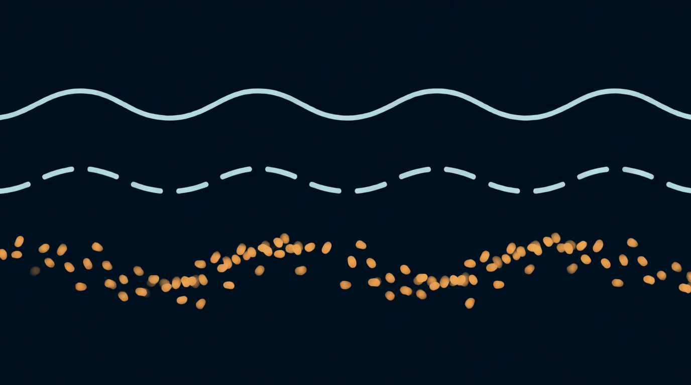

Глава 1

# Звук можно разрезать

<figure markdown="span">
  
  <figcaption>Иллюстрация 1.1. Звук режется на зёрна.</figcaption>
</figure>

Звук, который ты записал, лежит в компьютере длинным рядом чисел. Каждое число говорит, где в этот миг была мембрана микрофона: чуть вперёд или чуть назад. В одной секунде таких чисел 44 100 или 48 000, смотря как записан файл.

Раз это ряд чисел, его можно резать на куски любой длины. Гранулярный синтез режет звук на совсем короткие куски, обычно от 1 до 100 миллисекунд. Миллисекунда — это тысячная доля секунды. Кусок в 50 мс длится одну двадцатую секунды: ты его услышишь, но вряд ли узнаешь, откуда он вырезан.

Такой кусок с плавным началом и плавным концом зовут зерном, по-английски grain. Одно зерно почти ничего не значит, как одна капля ещё не дождь. Но запусти сотни зёрен в секунду, и родится новый звук: облако. Каким оно выйдет, решают четыре вещи: откуда брать зёрна, какой они длины, как часто летят и на какой высоте звучат.

## Главная суперсила

В магнитофоне и обычном сэмплере скорость, высота и длина звука сцеплены намертво. Ускорил запись вдвое, и она стала на октаву выше и вдвое короче. Замедлил, и она пошла ниже и тянется дольше. Отсюда голос бурундука и голос замедленного монстра.

Гранулятор эту сцепку рвёт. Он отдельно решает, откуда в файле брать зёрна, и отдельно, с какой высотой их играть. Отсюда приёмы, которых у сэмплера нет:

- **Заморозка.** Стоишь в одной точке файла, и звон ложки длится сколько хочешь, хоть десять минут.
- **Растяжение.** Три секунды звука проходишь за три минуты, а высота остаётся прежней.
- **Транспозиция без смены длины.** Звон играет на октаву ниже и длится ровно столько же.
- **Перемешивание.** Зёрна берутся из случайных мест файла, и звук рассыпается в мозаику.

??? info "Под капотом"

    При 48 кГц зерно в 50 мс содержит 2400 отсчётов. Высоту зерна гранулятор меняет так же, как сэмплер: читает отсчёты быстрее или медленнее и интерполирует между ними. Разница в том, что начало каждого нового зерна задаётся отдельно, и конец предыдущего на него не влияет. Поэтому скорость чтения внутри зерна (высота) и скорость движения позиции по файлу (время) становятся двумя независимыми ручками.

## Зачем зерну плавные края

Вырежи кусок звука ножницами, и на краях волна оборвётся. Обрыв ухо слышит щелчком. Сотня щелчков в секунду превращается в треск. Поэтому каждое зерно сначала плавно выходит из тишины, а в конце плавно в неё уходит. Эту форму громкости зовут огибающей зерна, или окном. Формы окна разберём в [главе 5](../chast-2-parametry/05-razmer-i-ogibayushchaya.md).

??? info "Под капотом"

    Щелчок рождается из разрыва: сигнал прыгает с ненулевого значения в ноль за один отсчёт. В резком скачке есть энергия на всех частотах сразу, отсюда широкополосный клик. Окно сводит амплитуду к нулю на краях, и скачку неоткуда взяться.

## Упражнение 1.1. Гранулятор руками { .exercise }

Опыт делается в любой DAW без плагинов.

1. Положи звук ложки на аудиодорожку.
2. Вырежи из середины звона кусок длиной 50 мс. Увеличь масштаб, чтобы попасть точно.
3. Скопируй кусок 20 раз подряд, встык. Звон стал ровным гудением, но на стыках трещит.
4. Сделай каждому куску фейд-ин и фейд-аут по 10–15 мс. Треск пропал. Ты только что собрал огибающую зерна.
5. Второй вариант: вырежи 20 кусков по 50 мс, каждый на 10 мс позже предыдущего, и поставь встык с теми же фейдами. Звон теперь медленно меняется, будто время притормозило, а высота та же. Это растяжение.
6. Третий вариант: вырежи 20 кусков из случайных мест всего файла. Вот и мозаика.

Гранулятор делает то же самое, только сотни раз в секунду, и вместо ножниц у него ручки.
