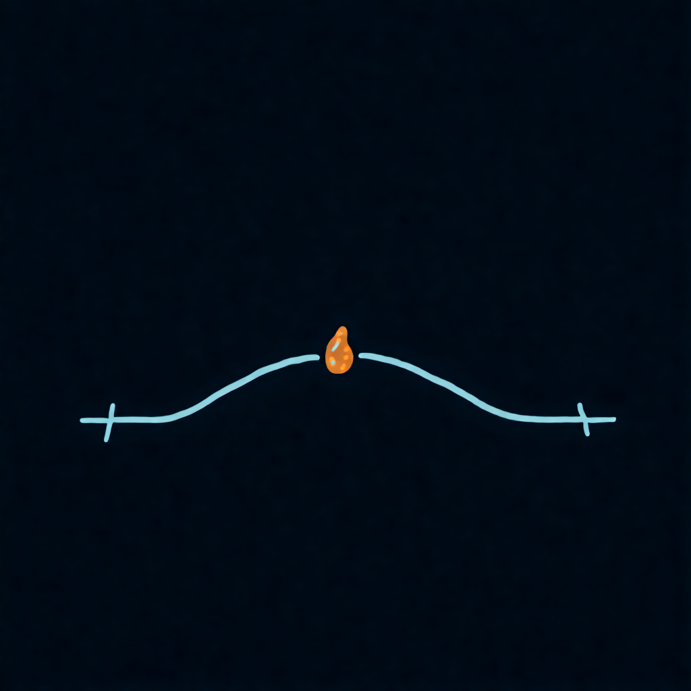
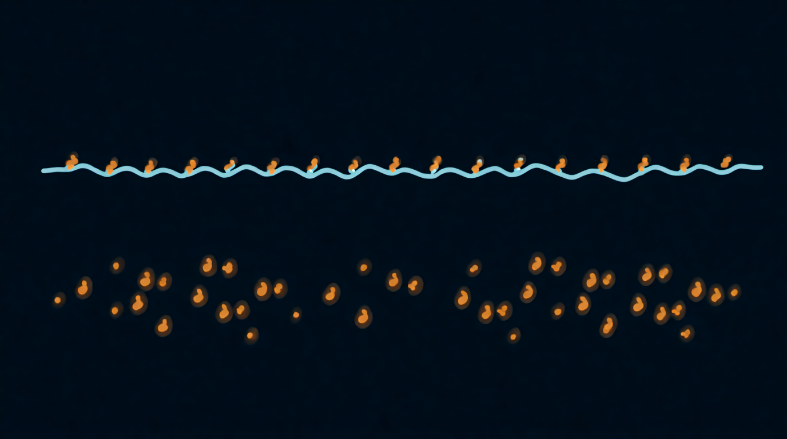

Kapitel 2

# Anatomie von Grain und Wolke

<figure markdown="span">
  
  <figcaption>Illustration 2.1. Die Anatomie eines einzelnen Grains.</figcaption>
</figure>

Jedes Grain hat eigene Eigenschaften, wie eine Note in einer Partitur:

- **Position**: von welcher Stelle der Datei es stammt;
- **Größe**: wie lange es dauert;
- **Hüllkurve**: wie es anschwillt und verklingt;
- **Tonhöhe**: mit welcher Geschwindigkeit sein Inhalt gelesen wird;
- **Lautstärke**;
- **Panorama**: wo es klingt, links oder rechts.

Bei der Wolke kommen zwei Eigenschaften hinzu. Die Dichte sagt, wie viele Grains pro Sekunde entstehen. Die Synchronität sagt, wie gleichmäßig sie zeitlich aufeinander folgen.

Im Synthesizer startet jede gedrückte Taste ihren eigenen Strom von Grains. Spielst du einen Akkord aus drei Tönen, hast du drei Wolken, jede auf ihrer Tonhöhe.

## Was das Ohr bei verschiedenen Längen hört

| Grain-Länge | Was man hört | Wofür es taugt |
| --- | --- | --- |
| bis 2 ms | ein Klick, die Quelle ist nicht erkennbar | Perkussion, Knistern, Glitch |
| 2–20 ms | ein gefärbter Klick, ein Summen; im dichten Strom eine neue Klangfarbe | Bässe, synthetische Stimmen, Metall |
| 20–100 ms | Ton und Farbe der Quelle sind erkennbar, aber nicht ihre Worte und ihr Rhythmus | Pads, Wolken, Dehnen |
| über 100 ms | ganze Fetzen der Quelle sind hörbar | Zerschneiden, Rhythmen, Mosaik |

Die Grenzen sind unscharf und verschieben sich mit dem Material. Eine Stimme erkennt man an kürzeren Grains als ein Rauschen, und den reinen Ton des Löffels erkennt man schon an ganz kurzen.

??? info "Unter der Haube"

    Truax hat die Erkenntnisse der Psychoakustik in ein einfaches Bild gefasst. Ein einzelner kurzer Klang bekommt bei etwa 13 ms eine Tonhöhe, und seine Klangfarbe entfaltet sich bis 40–50 ms vollständig. Daraus ergibt sich eine grobe Grenze um 50 ms: Deutlich kürzere Grains verschmelzen zu einer durchgehenden Textur, deutlich längere hört man als einzelne Ereignisse, und um 50 ms scheint der Klang in Schichten zu zerfallen. Ein Grain, das kürzer ist als eine Periode der Quelle, trägt ihre Tonhöhe überhaupt nicht und klingt wie ein breites Band ([Truax, 1988](https://doi.org/10.2307/3679938)).

## Überlappung

Grains können mit Pausen, lückenlos oder überlappend aufeinanderfolgen. Wie stark sie sich überlagern, ist leicht zu berechnen:

$$
O = d \times r
$$

Dabei ist d die Grain-Länge in Sekunden, r die Dichte in Grains pro Sekunde, und O zeigt, wie viele Grains im Mittel gleichzeitig klingen.

- 50 ms × 10 Grains pro Sekunde = 0,5. Zwischen den Grains sind Pausen, man hört ein Rattern.
- 50 ms × 20 = 1. Die Grains folgen lückenlos.
- 100 ms × 40 = 4. Vier Grains klingen gleichzeitig, die Wolke ist glatt.

Ein Wert unter eins bedeutet gepunktete Linie und Rhythmus. Ein Wert über eins bedeutet eine geschlossene Wolke, und je höher der Wert, desto dichter die Wolke und desto verschwommener die Quelle.

## Synchron und ungeordnet

<figure markdown="span">
  
  <figcaption>Illustration 2.2. Synchroner und asynchroner Strom.</figcaption>
</figure>

**Synchroner Strom.** Die Grains kommen in gleichen Abständen, wie die Schläge eines Metronoms. Solange es weniger als 15–20 pro Sekunde sind, hört man ein Rattern. Darüber unterscheidet das Ohr die einzelnen Schläge nicht mehr und hört einen Ton, und die Tonhöhe dieses Tons entspricht der Zahl der Grains pro Sekunde. 110 Grains pro Sekunde klingen wie der Ton A2, 220 wie A3. Und es spielt keine Rolle, was im Grain steckt: ein Löffel oder eine Stimme. Das Innere des Grains bestimmt die Farbe, die Grain-Rate bestimmt den Ton.

**Asynchroner Strom.** Die Abstände sind zufällig. Es gibt keinen Ton, sondern ein Rauschen, Regen, Kies, einen Schwarm. So klingen die klassischen Granularwolken.

**Quasi-synchroner Strom.** Die Abstände sind gleichmäßig, aber mit einer kleinen zufälligen Streuung. Der Ton bleibt, wird aber rau und lebendig, wie ein Chor oder ein gestrichenes Instrument.

Die Klangdemo läuft im Browser mit aktiviertem JavaScript.

??? info "Unter der Haube"

    Ein synchroner Grain-Strom ergibt ein periodisches Signal mit der Periode 1/r. Sein Spektrum besteht aus Harmonischen der Frequenz r, während die spektrale Hüllkurve, also die Formanten, vom Inhalt des Grains und der Fensterform bestimmt wird. Auf demselben Prinzip beruhen Xavier Rodets Formantsynthese FOF aus dem IRCAM und die Pulsar-Synthese, die Curtis Roads in seinem Buch „Microsound“ beschrieben hat. In einem asynchronen Strom gibt es keine Periode, und das Spektrum verschmiert zu einem durchgehenden Rauschband mit der Farbe der Quelle.

## Übung 2.1. Berechne die Wolke { .exercise }

Berechne die Überlappung und sag voraus, was du hören wirst. Die Antworten sind unten versteckt, öffne sie, wenn du gerechnet hast.

1. Grain 30 ms, 10 Grains pro Sekunde.
2. Grain 200 ms, 25 Grains pro Sekunde.
3. Grain 5 ms, synchron, 440 Grains pro Sekunde.

??? question "Antworten"

    Erstens: 0,3, ein dünnes Rattern mit Pausen. Zweitens: 5, eine dichte, glatte Wolke. Drittens: 2,2, ein geschlossener Ton, der Ton A4 mit der Farbe der Quelle.
