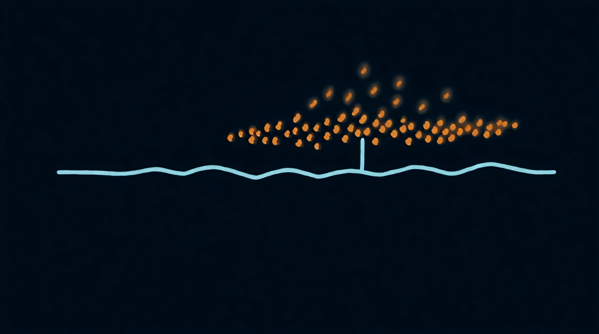

Capítulo 4

# Fuente y posición

<figure markdown="span">
  
  <figcaption>Ilustración 4.1. Posición y dispersión de la posición.</figcaption>
</figure>

## Fuente

El granulador no se inventa nada: todo lo que toca viene de una fuente, casi siempre de un archivo grabado. Una fuente mala no se volverá buena al pasar por el granulador, pero una buena mostrará una docena de caras.

Qué hace que un sonido sea una buena fuente:

- **Un espectro rico.** Un tintineo, una voz, una cuerda, el ruido de la calle dan a los granos mucho material. Un seno puro da un seno aburrido.
- **Cambio en el tiempo.** Si el sonido cambia a lo largo de su duración, cada posición del archivo suena distinta, y mover la posición se convierte en música. La cucharilla es así: el golpe, el tintineo, la cola.
- **Una grabación limpia.** El granulador multiplicará la saturación y los clics digitales en cientos de copias.
- **Sin silencio de sobra.** Un grano tomado del silencio suena a silencio. La nube empezará a caer en agujeros.

¿Estéreo o mono? Una fuente estéreo da a los granos su propia anchura; una mono la deja en manos del mando de panorama ([capítulo 8](../chast-2-parametry/08-prostranstvo-i-golosa.md)). Empieza en mono: así se entiende mejor qué hace cada mando.

La fuente no tiene por qué ser una grabación. En Quanta 2, a la entrada del granulador llegan las señales de dos osciladores integrados, del ruido y de un archivo cargado: cuatro deslizadores INPUT LEVELS las mezclan, y la mezcla se corta en granos. Por eso el granulador suena incluso sin archivo. Las ondas simples con dispersiones se convierten en una capa densa tipo «supersierra». El ruido suele dar solo más ruido, pero conviene mezclar un poquito con una grabación para darle densidad, o construir percusión con él. En Serum 2 también se pueden granular no solo grabaciones, sino tablas de ondas ([capítulo 10](../chast-3-instrumenty/10-serum-2.md)).

## Posición

La posición dice de qué lugar del archivo se toma el siguiente grano. Es el mando principal del granulador, porque controla el tiempo.

**Cómo se llama en las interfaces:** Position, Pos, Start, Scan, Playhead, Offset.

La posición se fija en porcentaje de la duración del archivo, en milisegundos o con un cursor directamente sobre el dibujo de la onda. Se puede mover de tres maneras.

**Quedarse quieto (congelación).** La posición no se mueve y todos los granos se toman del mismo punto. El sonido en ese punto se prolonga sin fin. Lo que mejor se congela son los lugares estables: una vocal en una voz, el centro de un tintineo, una nota sostenida de una cuerda. El ataque se congela peor: los granos del golpe dan un zumbido parecido a un motor.

**Moverla a mano.** Giras el mando y recorres el archivo a cualquier velocidad, hacia delante y hacia atrás. El sonido se convierte en un instrumento que tocas con el tiempo.

**Moverla automáticamente (escaneo).** La posición avanza sola por el archivo a una velocidad dada. Una velocidad del 100 % es el tempo original. El 50 % es la mitad de rápido, el 0 % es una congelación y una velocidad negativa es hacia atrás.

$$
T_{\text{new}} = \frac{T_{\text{source}}}{s}
$$

Aquí s es la velocidad de escaneo (1 = 100 %) y T es la duración. Una cucharilla de 3 segundos a una velocidad del 1 % suena 300 segundos, es decir, 5 minutos, a la misma altura.

## Ventana de lectura

Muchos granuladores permiten limitar el fragmento del archivo por el que se mueve la posición: un inicio y un final, a veces con bucle. Puedes encerrar el sonido de la cucharilla en la zona del tintineo y descartar el golpe.

**Cómo se llama:** Start/End, Loop, Region, Window, Range.

## Dispersión de la posición

La dispersión dice cuánto puede alejarse cada grano de la posición. Con dispersión 0, todos los granos se toman del mismo punto. Con 20 ms, cada grano se toma al azar de algún lugar a menos de 20 ms de él.

**Cómo se llama:** Spray, Jitter, Scatter, Random Position, Pos Rand, Variation.

| Dispersión | Qué se oye |
| --- | --- |
| 0 | congelación pura, puede sonar «a máquina», con un zumbido de fondo |
| 5–30 ms | el sonido cobra vida, el zumbido se va, aparece un chorus suave |
| 50–300 ms | la fuente se difumina, nace una nube |
| todo el archivo | un mosaico: granos del golpe, del tintineo y de la cola mezclados |

Es el primer mando que conviene subir si un sonido congelado parece mecánico.

??? info "Bajo el capó"

    El zumbido con dispersión cero aparece porque todos los granos son idénticos: un flujo de granos idénticos se convierte en una señal periódica, y la frecuencia de los granos asoma como un tono aparte ([capítulo 2](../chast-1-zerno/02-anatomiya-zerna.md)). La dispersión de la posición hace distintos a los granos vecinos y rompe esa periodicidad. En el fondo es una decorrelación, el mismo truco en el que se basa un chorus.

## Entrada en vivo

Algunos granuladores pueden tomar granos de un sonido que está entrando ahora mismo: de un micrófono, una guitarra, una pista vecina. El sonido se escribe en un búfer circular corto, y la posición se mueve por él. Así el granulador se convierte en un efecto. Cuáles de nuestros tres instrumentos saben hacerlo lo veremos en la [parte 3](../chast-3-instrumenty/index.md).

## Ejercicio 4.1. Tres puntos de la cucharilla { .exercise }

1. Carga la cucharilla en cualquier granulador. Escaneo a 0, dispersión a 0.
2. Pon la posición en el golpe. Escucha el zumbido.
3. Pon la posición en el centro del tintineo. Escucha el tono estable.
4. Pon la posición en la cola, donde casi hay silencio. Un susurro débil y huecos.
5. Vuelve al tintineo y sube despacio la dispersión de 0 al máximo. Recuerda el punto en el que el tono se convierte en nube.
