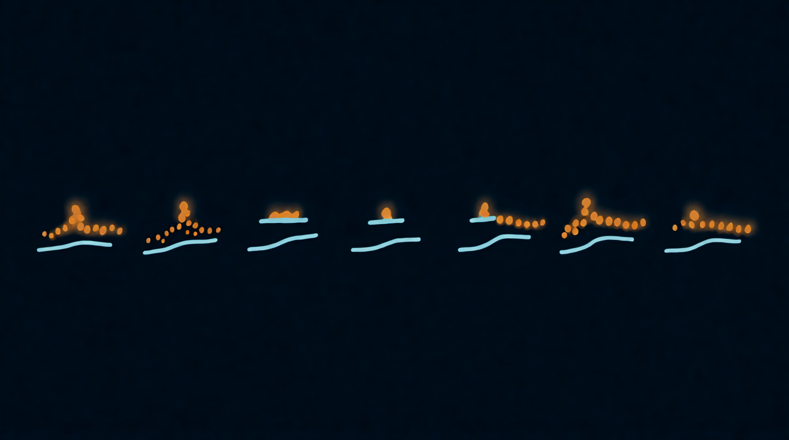

Глава 5

# Размер зерна и огибающая

<figure markdown="span">
  
  <figcaption>Иллюстрация 5.1. Формы окна зерна.</figcaption>
</figure>

## Размер

Размер говорит, сколько длится каждое зерно. Это вторая главная ручка после позиции, и она решает, узнаешь ли ты исходник.

**Как называется:** Size, Length, Duration, Grain Size, Window Size.

Задают размер тремя способами, и полезно понимать, какой из них стоит в твоём инструменте:

- **В миллисекундах.** Самый частый вариант. 50 мс остаются 50 мс на любой ноте.
- **В долях такта.** Размер привязан к темпу проекта: 1/16, 1/32. Удобно для ритмичных нарезок.
- **Относительно высоты.** Размер считается в периодах звучащей ноты, и на высоких нотах зёрна сами становятся короче. Так устроены движки, где зёрна дают тон ([глава 6](../chast-2-parametry/06-plotnost-i-sinkhronnost.md)).

Что происходит, когда крутишь размер вниз от 500 мс до 1 мс:

1. **500–100 мс.** Слышны куски исходника, ложка узнаётся целиком, с атакой.
2. **100–30 мс.** Атака размывается, остаётся тон и окраска. Зона красивых пэдов.
3. **30–10 мс.** Исходник едва узнаётся, звук становится зернистым и шершавым.
4. **10–1 мс.** Тембр исходника пропадает, остаются щелчки, жужжание, шипение. В синхронном потоке тут рождаются новые тембры.

Размер и плотность работают в паре (формула перекрытия в [главе 2](../chast-1-zerno/02-anatomiya-zerna.md)). Уменьшил размер, не трогая плотность, и облако поредело, появились дыры. Чтобы сохранить гладкость, при коротких зёрнах поднимай плотность.

??? info "Под капотом"

    Короткое зерно звучит шире длинного из-за соотношения неопределённости: длительность сигнала и ширина его спектра обратно пропорциональны. Зерно в 2 мс, вырезанное из чистого тона 440 Гц, содержит меньше одного периода этого тона, и спектр размазывается на тысячи герц. Зерно в 100 мс содержит 44 периода, и спектр остаётся узким пиком на 440 Гц.

## Огибающая зерна

Огибающая решает, как громкость зерна меняется от начала до конца. Ты уже знаешь, зачем она нужна: убрать щелчки. Но форма огибающей заодно сильно влияет на звук.

**Как называется:** Window, Envelope, Shape, Grain Env, Smoothness, Contour.

| Форма | Как выглядит | Как звучит |
| --- | --- | --- |
| Колокол (Hann) | плавный подъём, плавный спад | мягко, без щелчков; рабочая форма по умолчанию |
| Гаусс | колокол уже и с длинными хвостами | ещё мягче, но слышна меньшая часть зерна; звук туманнее |
| Трапеция (Tukey) | быстрый подъём, ровная полка, быстрый спад | больше исходника, ярче и разборчивее; на коротких зёрнах может цокать |
| Треугольник | прямой подъём, прямой спад | между колоколом и трапецией, чуть жёстче колокола |
| Перкуссия | мгновенная атака, долгий спад | каждое зерно как маленький щипок: капли, стеклянные звоны, плаки |
| Обратная перкуссия | долгий подъём, мгновенный обрыв | зёрна всасываются, звук как запись задом наперёд |
| Прямоугольник | нет подъёма и спада | щелчки на каждом зерне, жёсткий цифровой треск, глитч |

Перкуссионные окна в разных программах называются похоже. В Pigments это Expodec (от exponential decay, экспоненциальный спад) и обратное ему Rexpodec, в Serum 2 ExpDec и Exp Dec Rev, в грануляторе Borderlands EXPDEC и его обращённая во времени версия. Увидел такое название, значит, перед тобой капля или её отражение.

Часто вместо выбора формы дают одну или две ручки:

- **Сглаживание (Smooth).** Двигает форму от прямоугольника к колоколу. Ноль значит треск, максимум значит мягкость.
- **Перекос (Skew, Tilt, Attack/Decay).** Сдвигает пик огибающей к началу или к концу зерна. Пик в начале даёт перкуссию, пик в конце даёт обратную перкуссию.

Звуковое демо работает в браузере с включённым JavaScript.

??? info "Под капотом"

    Окно умножается на зерно, а умножение во времени — это свёртка в спектре: спектр окна размазывает спектр исходника. У окон с плавными краями (Hann, Гаусс) главный лепесток чуть шире, зато боковые лепестки на десятки децибел ниже, поэтому они добавляют мало шума. Прямоугольное окно даёт высокие боковые лепестки, отсюда треск. Трапеция стоит посередине: полка пропускает больше исходника, но крутые края поднимают боковые лепестки.

## Упражнение 5.1. Форма решает { .exercise }

1. Ложка, позиция в звон, разброс 10 мс, плотность средняя.
2. Размер 80 мс. Переключи все доступные формы огибающей и запиши для себя по одному слову на каждую.
3. Размер 5 мс. Повтори. Заметь, что на коротких зёрнах разница между формами слышна сильнее.
4. Найди перкуссионную форму, поставь плотность пониже. Ложка рассыпалась на капли.
