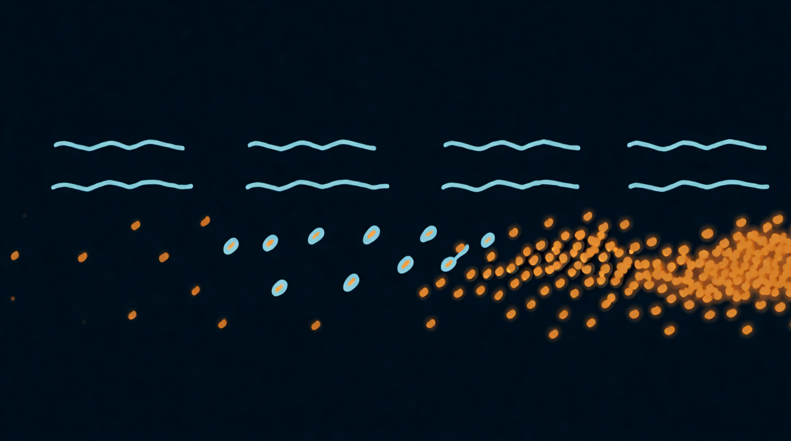

Глава 6

# Плотность и синхронность

<figure markdown="span">
  
  <figcaption>Иллюстрация 6.1. Плотность: от капель к облаку.</figcaption>
</figure>

## Плотность

Плотность говорит, сколько зёрен рождается за секунду на одну ноту. Это ручка, которая превращает дробь в облако.

**Как называется:** Density, Rate, Grains, Frequency, Grain Rate, Spawn Rate, Interval. Если ручка называется Interval или Period, она работает наоборот: задаёт паузу между зёрнами в миллисекундах, и чем больше число, тем реже зёрна.

Три способа задать плотность:

- **Зёрен в секунду, в герцах.** 10 Гц значит 10 зёрен в секунду.
- **В долях такта.** 1/16 значит зерно на каждую шестнадцатую. Зёрна попадают в сетку, гранулятор становится ритм-машиной.
- **От высоты ноты.** Частота зёрен следует за клавиатурой, и зёрна сами дают тон (ниже).

Что слышно по мере роста плотности, при размере зерна 50 мс:

| Плотность | Перекрытие | Что слышно |
| --- | --- | --- |
| 2–8 зёрен/с | 0,1–0,4 | отдельные капли, пуантилизм, редкий дождь |
| 10–20 | 0,5–1 | дробь, тремоло, зёрна почти встык |
| 30–100 | 1,5–5 | гладкое облако, хорус |
| 100 и выше | больше 5 | плотная стена, исходник размыт, звук похож на шум с окраской |

Звуковое демо работает в браузере с включённым JavaScript.

## Громкость растёт вместе с плотностью

Чем больше зёрен звучит разом, тем громче облако. Удвоил плотность, и уровень вырос примерно на 3 дБ, если зёрна разные. Если зёрна одинаковые и совпадают по фазе, рост будет 6 дБ. Поэтому, поднимая плотность, следи за выходом и убавляй громкость. Некоторые грануляторы компенсируют это сами.

??? info "Под капотом"

    Некоррелированные сигналы складываются по мощности: N зёрен дают амплитуду, пропорциональную корню из N, то есть +3 дБ на каждое удвоение. Коррелированные складываются по амплитуде: N зёрен дают амплитуду в N раз больше, +6 дБ на удвоение. Разброс позиции и высоты как раз декоррелирует зёрна и спасает от резких скачков громкости.

## Синхронность

Глава 2 ввела три режима потока: синхронный, асинхронный и почти синхронный. В интерфейсах между ними обычно переключают одной ручкой.

**Как называется:** Sync, Async, Random Rate, Rate Jitter, Spray (во времени), Irregularity, Chaos.

- **Разброс времени 0.** Зёрна идут как метроном. Выше 20 зёрен в секунду рождается тон.
- **Разброс времени средний.** Тон шершавый, живой, как хор или смычок.
- **Разброс времени максимальный.** Тона нет, есть облако, шорох, рой.

## Зёрна как генератор ноты

Самый неожиданный приём гранулярного синтеза. Свяжи плотность с клавиатурой: нажал ля первой октавы, и зёрна идут 440 раз в секунду, синхронно. Теперь гранулятор играет нотами, хотя позиция стоит на месте и высоту зерна ты не трогал.

Внутренность зерна при этом решает тембр. Зерно из звона ложки даст металлическую ноту, зерно из гласной «а» даст ноту с окраской «а». Так из записанного голоса собирается синтетический хор, а из стука по столу собирается бас.

В таком режиме у звука две высоты сразу. Одну задаёт частота зёрен, это нота. Вторую задаёт высота внутри зерна ([глава 7](../chast-2-parametry/07-vysota-i-napravlenie.md)), это окраска, форманта. Двигаешь высоту зерна, и нота стоит, а тембр «открывается» и «закрывается», как рот при пении.

??? info "Под капотом"

    Этот принцип лежит в основе FOF-синтеза и пульсарного синтеза. Частота следования зёрен r задаёт основной тон. Длительность зерна и его содержимое задают спектральную огибающую: где спектр поднимается, там форманта. Если размер зерна больше периода 1/r, зёрна перекрываются и форманты становятся уже; если меньше, между зёрнами тишина, и спектр становится шире и «пульсарнее».

## Упражнение 6.1. Дождь и нота { .exercise }

1. Ложка, позиция в звон, размер 30 мс, разброс позиции 10 мс.
2. Плотность 3 зерна в секунду, асинхронно. Редкие капли.
3. Плавно поднимай плотность до 200. Отметь, где капли слились в облако.
4. Убери разброс времени в ноль. Подними плотность за 100. Услышь, как облако загудело тоном.
5. Если в инструменте плотность можно связать с клавиатурой, сыграй гамму. Ты играешь ложкой мелодию, а позиция всё это время стоит на месте.

*Иллюстрация 6.1. Плотность: от капель к облаку.*
