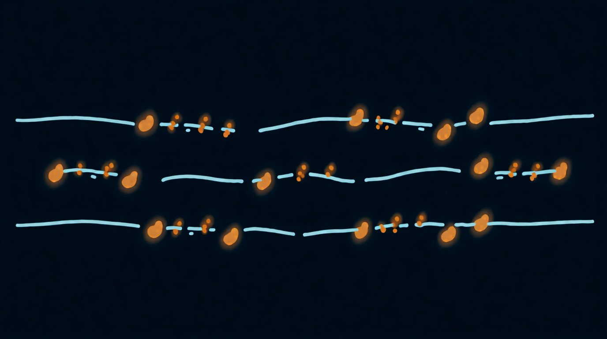

Kapitel 7

# Tonhöhe, Richtung und Tonhöhenstreuung

<figure markdown="span">
  
  <figcaption>Illustration 7.1. Tonhöhenstreuung in Oktaven.</figcaption>
</figure>

## Grain-Tonhöhe

Die Grain-Tonhöhe entscheidet, mit welcher Geschwindigkeit der Granulator den Klang innerhalb jedes Grains liest. Liest er doppelt so schnell, klingt das Grain eine Oktave höher. Halb so schnell, eine Oktave tiefer. Das Wichtigste: Auf die Position hat das keinerlei Einfluss, die Zeit läuft durch die Datei wie zuvor.

**So heißt sie:** Pitch, Tune, Transpose, Grain Pitch, Coarse/Fine, Semi/Cent.

Meist wird die Tonhöhe mit zwei Reglern eingestellt: einem groben in Halbtönen und einem feinen in Cent (Hundertstel eines Halbtons). Dazu kommt die Tastatur: Im Synthesizer transponiert die gedrückte Taste die Grains relativ zum Grundton, wie bei einem Sampler.

Ein wichtiges Detail. Wenn die Tonhöhe über die Lesegeschwindigkeit verändert wird, wandert die Klangfarbe mit dem Ton mit. Der Löffel zwei Oktaven tiefer klingt wie eine Domglocke, zwei Oktaven höher wie Glasstaub. Eine Stimme eine Oktave höher wird zur Mickymaus, obwohl sich die Länge des Klangs nicht geändert hat. Diese Eigenschaft lässt sich leicht zum Instrument machen: Die Grain-Tonhöhe wirkt wie ein Regler für die „Größe“ der Quelle.

??? info "Unter der Haube"

    Eine Änderung der Lesegeschwindigkeit um den Faktor k multipliziert alle Frequenzen im Grain mit k, die Formanten eingeschlossen. Manche Engines können die Tonhöhe formanterhaltend verschieben, aber das ist schon spektrale Bearbeitung zusätzlich zur granularen. Und im synchronen Modus aus [Kapitel 6](06-plotnost-i-sinkhronnost.md) ist es umgekehrt: Den Ton bestimmt die Grain-Rate, und die Grain-Tonhöhe verschiebt nur die Formanten.

## Tonhöhenstreuung

Die Tonhöhenstreuung gibt jedem Grain eine zufällige Abweichung vom Hauptton. Sie ist einer der schönsten Regler eines Granulators.

**So heißt sie:** Pitch Spread, Pitch Random, Pitch Jitter, Detune, Pitch Scatter.

| Streuung | Was man hört |
| --- | --- |
| 1–10 Cent | ein leichter Chorus, der Klang ist breiter und wärmer |
| 10–50 Cent | eine schwebende, „betrunkene“ Verstimmung, ein Klang wie von altem Band |
| einige Halbtöne | eine Wolke benachbarter Töne, ein Cluster, ein Nebel |
| Oktaven | die Grains springen zwischen den Lagen, ein Schimmern |

??? info "Unter der Haube"

    Truax nennt eine genaue Grenze für Sinus-Grains: Solange das Frequenzband schmaler ist als etwa 10 % der mittleren Frequenz (eine Streuung von etwa ±5 %, also ±85 Cent), hört das Ohr noch eine Tonhöhe. Wird es breiter, wird der Ton zu einem schmalen Rauschband und dann zu breitem Rauschen ([Truax, 1988](https://doi.org/10.2307/3679938)). Bei Grains aus einer Aufnahme ist die Grenze unschärfer, weil der Klang im Grain sein eigenes Spektrum hat, aber die Richtung ist dieselbe.

Bei vielen Granulatoren lässt sich die Streuung an Intervalle binden. Dann nimmt jedes Grain seine Tonhöhe nur aus einem vorgegebenen Satz: Oktaven, Quinten, Skalentöne.

- **Nur Oktaven.** Der Klang schimmert wie Lichtreflexe auf dem Wasser, bleibt aber auf einem Ton. Ein klassischer Ambient-Trick.
- **Oktaven und Quinten.** Ein schimmernder Orgelakkord.
- **Skalentöne.** Jedes Grain spielt einen zufälligen Ton der Skala, und eine einzige gedrückte Taste lässt eine Akkordwolke entstehen.

In Quanta 2 heißt dieses Raster QUANT: Eine Taste mit einer Klaviatur neben dem Regler TUNE öffnet ein kleines Fenster mit Tasten. Schalte die gewünschten Töne ein, und jedes Grain spielt nur diese. Schaltest du alle zwölf ein, gehen die Grains auf beliebige Töne der Oktave; schaltest du nur die untere Reihe ein, nur auf Töne ohne Vorzeichen. Die Quantisierung berücksichtigt die aktuelle Stimmung des Plugins, funktioniert also auch mit nichtstandardmäßigen Stimmungen. So bleibt die Wolke in der Tonart des Tracks.

Die Klangdemo läuft im Browser mit aktiviertem JavaScript.

## Richtung

Ein Grain lässt sich rückwärts lesen. Ein kurzes rückwärts gespieltes Grain ist vom Gehör kaum von einem vorwärts gespielten zu unterscheiden, aber bei Grains über 50 ms drehen sich die Anschläge um, und der Klang beginnt „eingesogen“ zu werden.

**So heißt sie:** Reverse, Direction, Rev Prob, Backwards.

Oft gibt es eine Wahrscheinlichkeit: 0 % bedeutet, alle Grains laufen vorwärts, 100 %, alle rückwärts, 50 %, gemischt. Die Mischung ergibt einen wankenden, unsicheren Klang, als würde die Zeit taumeln.

In Quanta 2 hat die Grain-Richtung fünf Modi. FORWARD und REVERSE spielen die Grains vorwärts oder rückwärts. PLAY DIR folgt der Bewegung der Position: Fährt die Position zum Dateiende, laufen die Grains vorwärts, fährt sie zum Anfang, rückwärts. -PLAY DIR arbeitet umgekehrt. RANDOM wählt die Richtung für jedes Grain zufällig. Ein rückwärts gespieltes Grain liest denselben Abschnitt der Datei wie ein vorwärts gespieltes, nur rückwärts, deshalb verschiebt sich die Grenze des Abschnitts nicht.

??? info "Unter der Haube"

    Warum ein kurzes rückwärts gespieltes Grain wie ein vorwärts gespieltes klingt, hat Truax erklärt: Das Fenster eines Grains ist symmetrisch, und eine Textur aus synthetisierten Grains lässt sich ohne jede Klangfarbenänderung rückwärts abspielen. Solche Texturen nannte er palindromisch ([Truax, 1988](https://doi.org/10.2307/3679938)). Ein Grain aus einer Aufnahme hat eine eigene innere Bewegung, Anschlag und Abklingen, deshalb ist die Umkehrung bei langen Grains schon zu hören.

## Gleiten innerhalb des Grains

In manchen Engines lässt sich die Tonhöhe direkt innerhalb eines Grains ändern: Jedes beginnt auf einem Ton und gleitet zu einem anderen. Kurze Grains mit fallender Tonhöhe klingen wie Tropfen oder ein Laser-„Piu“, lange wie ein Stöhnen. Hat dein Instrument keinen solchen Regler, ist das kein Problem: Eine schnelle Tonhöhenmodulation ergibt einen ähnlichen Effekt ([Kapitel 9](../chast-2-parametry/09-modulyaciya.md)). Curtis Roads hat für solche Grains einen eigenen Namen: Glissons, und die Synthese daraus heißt Glisson-Synthese.

## Übung 7.1. Ein Akkord aus einem Löffel { .exercise }

1. Der Löffel, Position im Klingen, Größe 100 ms, Dichte 40, Positionsstreuung 20 ms.
2. Spiel den Ton C. Das Klingen ist zu diesem Ton geworden.
3. Stell die Tonhöhe auf −24 Halbtöne. Der Löffel ist zur Glocke geworden.
4. Setz die Tonhöhe zurück. Gib eine Tonhöhenstreuung von 15 Cent. Der Klang ist breiter geworden.
5. Wenn sich die Streuung an Intervalle binden lässt, wähle Oktaven und erhöhe die Streuung auf ±1 Oktave. Schimmern.
6. Stell die Rückwärts-Wahrscheinlichkeit auf 50 %. Hör, wie wankend es geworden ist.
