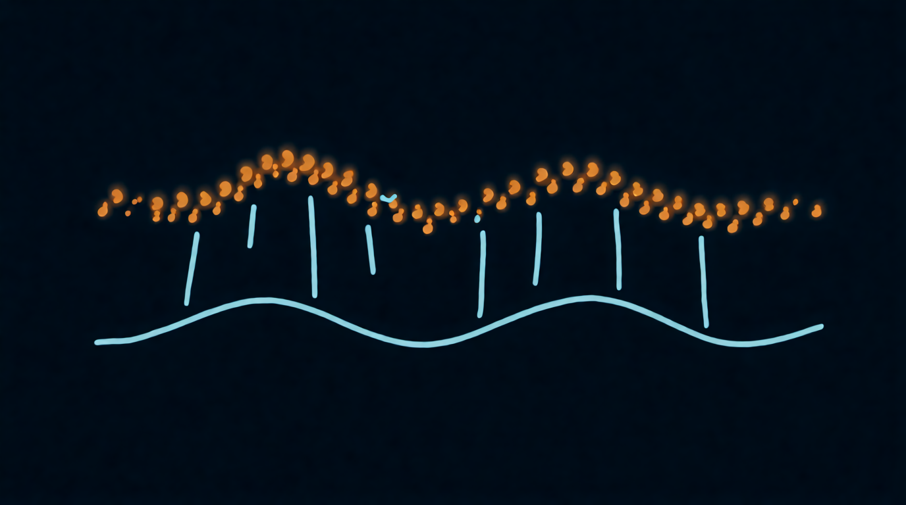

Глава 9

# Модуляция: звук, который живёт сам

<figure markdown="span">
  
  <figcaption>Иллюстрация 9.1. LFO двигает поток зёрен.</figcaption>
</figure>

Если все ручки стоят на месте, облако звучит красиво, но статично, как фотография. Модуляция двигает ручки сама, без твоих рук, и фотография становится фильмом. В гранулярном синтезе модуляция особенно важна: зёрна и так случайны в мелочах, а модуляция даёт им движение в крупном.

## Источники модуляции

**LFO, низкочастотный генератор.** Качает параметр туда-сюда по кругу. Главные настройки: скорость (в герцах или в долях такта), форма (синус, треугольник, пила, квадрат, случайные ступени), глубина.

- Медленный синус на позиции (0,05–0,2 Гц) заставляет облако дрейфовать по файлу, и звук меняется каждые несколько секунд.
- Случайные ступени (Sample & Hold) на позиции, в такт четвертям: на каждую долю зёрна берутся из нового места. Готовая ритмичная нарезка.
- Быстрый LFO на высоте зерна (5–7 Гц, глубина 20–50 центов) даёт вибрато.

**Огибающая, ADSR.** Меняет параметр один раз за ноту: от нажатия до отпускания.

- Огибающая на позиции: каждая нота начинается со стука ложки и уезжает в звон. Звук проигрывается как сэмпл, но с гранулярным характером.
- Огибающая на размере: в начале ноты зёрна короткие и щёлкают, к концу длинные и гладкие. Атака с хрустом, хвост мягкий.
- Огибающая на плотности: облако разгорается и гаснет вместе с нотой.

**Исполнение.** Параметры, которыми управляешь руками в момент игры:

- **Сила нажатия (velocity).** Сильнее ударил, больше разброс позиции. Тихие ноты чистые, громкие рассыпаются.
- **Колесо модуляции.** Самое частое назначение для гранулятора: размер зерна или разброс. Одна рука играет, другая крутит облако.
- **Послекасание (aftertouch) и MPE.** Давишь сильнее на клавишу, и облако раскрывается.
- **Номер ноты (keytrack).** Высокие ноты получают короткие зёрна, низкие длинные. Так звук ровнее звучит по всей клавиатуре.

**Случайность на ноту.** Новое случайное значение при каждом нажатии. Например, случайная стартовая позиция: каждая нота начинается из своего места файла, и даже повторяющаяся партия не звучит одинаково.

## Глубина и полярность

У каждой связи «источник → параметр» есть глубина: насколько далеко модуляция двигает ручку. И знак: плюс двигает в одну сторону, минус в другую. Глубина важнее скорости. Начинай с малой глубины и добавляй, пока не услышишь движение, потом откати чуть назад. Самая частая ошибка новичка: модуляция на полную, и звук превращается в карусель.

## Связки параметров

Самые выразительные звуки получаются, когда одна ручка двигает несколько параметров сразу, иногда в разные стороны. Для этого служат макросы.

**Как называется:** Macro, Quick Control, Performance Control, Morph.

| Связка | Что делает |
| --- | --- |
| размер вниз + плотность вверх | облако становится мельче и гуще, не проваливаясь в дыры |
| разброс позиции вверх + разброс высоты вверх | исходник растворяется в тумане |
| позиция по файлу + яркость фильтра | звук «просыпается» к концу файла |
| плотность вниз + реверб вверх | капли падают в пустой большой зал |
| скан вниз + размер вверх | время замирает, звук превращается в длинный пэд |

За вечер стоит собрать себе один такой макрос «тон → облако» и играть им как фейдером. На сцене это главная ручка всего инструмента.

## Модуляция или автоматизация

Внутреннюю модуляцию синтезатор делает сам, она повторяется на каждой ноте. Автоматизация в DAW рисуется по таймлайну трека: например, разброс медленно растёт весь второй куплет. Используй обе: модуляция даёт жизнь каждой ноте, автоматизация даёт форму всему треку.

??? info "Под капотом"

    Модуляция позиции LFO звуковой частоты (выше 20 Гц) перестаёт быть движением и становится тембром: позиция качается так быстро, что зёрна читают звук с частотной модуляцией внутри. То же с высотой зерна: LFO в звуковом диапазоне на высоте даёт боковые полосы, как в FM-синтезе. Не все инструменты пускают LFO так высоко, но где пускают, получаются металлические и колокольные тембры из любого исходника.

## Упражнение 9.1. Дышащий пэд { .exercise }

1. Ложка, позиция в звон, размер 120 мс, плотность 30, разброс позиции 30 мс, разброс высоты 10 центов, панорама 50%.
2. Повесь медленный синус-LFO (0,1 Гц) на позицию, глубина такая, чтобы позиция гуляла по всему звону.
3. Повесь огибающую на плотность: атака 2 секунды, отпускание 4 секунды.
4. Колесо модуляции назначь на размер зерна в минус: крутишь колесо, и зёрна мельчают.
5. Возьми долгий аккорд и поиграй колесом. Это первый законченный гранулярный инструмент из ложки.

*Иллюстрация 9.1. LFO двигает поток зёрен.*
