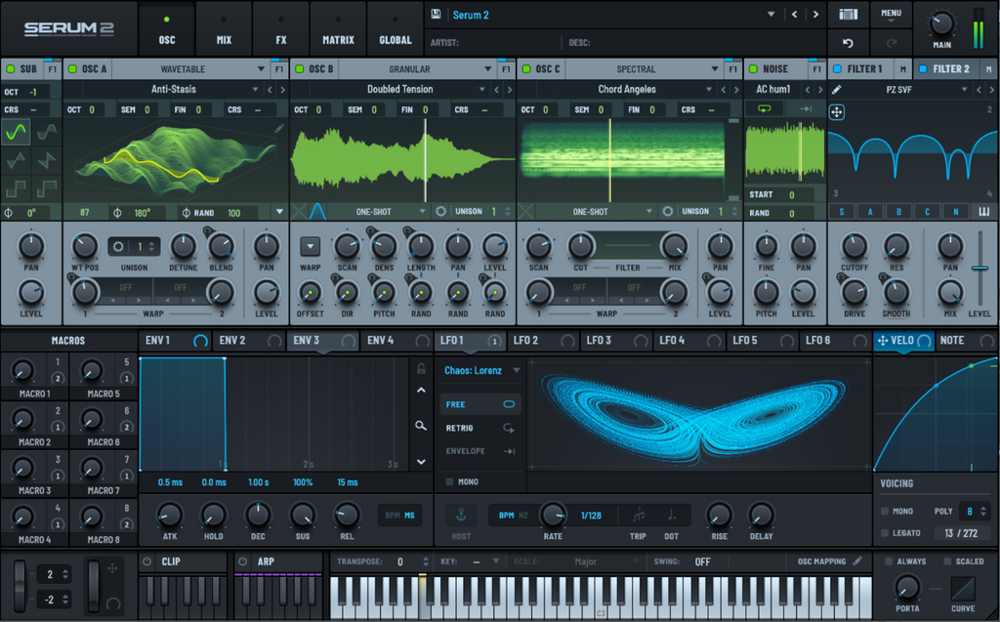

Chapter 10

# Xfer Serum 2

In Serum 2 the granulator lives inside the oscillator. Any of the three main oscillators (OSC A, OSC B, OSC C) can be switched to one of five modes: Wavetable, Multisample, Sample, Granular, Spectral. So a single patch can hold up to three independent granulators, with a sub and a noise oscillator alongside.

!!! note "About the version"

    The description corresponds to Serum 2 version 2.0.18. Note that the manual warns that the granular mode loads the processor more than the Wavetable, Sample and Multisample modes.

<figure markdown="span">
  
  <figcaption>Screenshot 10.1. OSC B in Granular mode with a loaded sound. Serum 2 interface, © Xfer Records.</figcaption>
</figure>

## Switching on and loading a sound

1. Click the oscillator's header and choose **Granular** in the context menu.
2. If this oscillator already had a sample in Sample or Spectral mode, it appears on the display at once. Otherwise the display is empty.
3. Open the sample drop-down menu. It holds the factory tonal and non-tonal samples, and also Serum's wavetables: you can granulate those too. Your own file is loaded with the **Load Sample** item. Reviews say that you can also simply drag a file onto the display ([PML](https://www.productionmusiclive.com/blogs/news/how-to-use-granular-synthesis-in-serum-2)).
4. After loading, the same menu will show the file on disk or reload it.

For drones, turning off pitch tracking is useful. Right-click the oscillator's header and clear **Enable Pitch Tracking**. Then Granular mode plays the note C3 on any key. **Pitch Bend Tracking** appears there too: turn that off as well if the pitch wheel shouldn't touch the drone.

## Where the Part 2 parameters are

| Parameter from Part 2 | Where in Serum 2 |
| --- | --- |
| Reading window (chapter 4) | start and end markers, loop LS and LE |
| Scan and freeze (chapter 4) | the **SCAN** knob, zero stops it |
| Manual position (chapter 4) | the **Manual** mode in the loop menu |
| Size (chapter 5) | the **LENGTH** knob and its modes |
| Envelope (chapter 5) | the window button: **AMOUNT**, **SKEW**, **SHAPE** |
| Density and synchronicity (chapter 6) | the **DENS** knob and its modes |
| Pitch (chapter 7) | **OCT**, **SEM**, **FIN**, **CRS** |
| Spreads (chapters 4, 5, 7, 8) | bottom row: **OFFSET**, **DIR**, **PITCH**, **RAND** of length, pan, level |
| Pan and volume (chapter 8) | **PAN**, **LEVEL** |
| Voices (chapter 8) | **UNISON** and the Voicing section |

## Markers and sample operations

Hover the cursor over the waveform and the start and end markers appear. Drag them to lock the granulator into the spoon's ring and throw out the knock. This is the reading window from [chapter 4](../chast-2-parametry/04-istochnik-i-poziciya.md).

Right-clicking the waveform opens the operations menu. According to the manual, almost all of them match Sample mode:

- **Snap Off / Snap to Zero / Snap to Beats / Snap to Loop.** What the markers stick to: nothing, the waveform's zero crossings, tempo beats, loop points. Snap to Zero saves you from clicks at the edges.
- **Fade Edges.** Fades at the edges of the sample, from 1 to 128 ms.
- **Normalize.** Raises the level to full scale without clipping.
- **Reverse.** Reverses the whole sample.
- **Trim.** Cuts the sample to the markers.
- **Slice Auto / Slice Manual.** Cuts the sample at attacks and lays the pieces out across the keys. The yellow line on the waveform sets the threshold: the lower the line, the more pieces. In manual mode an Alt-click (Option-click on Mac) adds or removes a cut. In Manual loop mode slicing is unavailable.
- **Show Marker Animation.** The markers move along with modulation, so you can see where the LFO drives the window.
- **Zoom to Start and End.** Locks the view to the whole file. While this item is off, vertical mouse movement over the waveform changes the zoom and horizontal movement scrolls.

The operations are non-destructive: the original file isn't changed, undo and redo work, and **Reload Sample** in the sample menu returns the file as it was.

## The loop menu

The loop menu decides how the granulator moves through the sample. Most items are shared with Sample mode, two exist only in Granular.

| Item | What it does |
| --- | --- |
| One-shot | the file is played through once forwards while you hold the note |
| Fwd Loop | from the start marker to the loop end, then again from the loop start |
| Rev Loop | having reached the loop end, goes backwards |
| Fwd/Rwd Loop | a pendulum loop: there and back, without sharp joins |
| Tailed | plays the second half of the file and loops the tail while the volume fades |
| Relative Loop | the loop travels along with the start marker |
| Link Loop Length | when the loop start is shifted, its length is kept |
| Exit Loop on Release | on key release exits the loop and plays the file to its end |
| **Loop Grains** | Granular only: grains respect the loop markers |
| **Manual** | Granular only: the position is set by hand (below) |

The loop markers are blue, and they appear at the top edge of the display. They can be dragged separately, together (by the span between them) or set as numbers in the **LS** and **LE** fields. The loop doesn't go beyond the sample's start and end markers. But if modulation or automation brings the loop end ahead of the start, the direction of the loop turns around. A ready-made trick for grains that alternate between forwards and backwards.

**Loop crossfade** in Granular mode applies to the grains themselves and works only when Loop Grains is on. The crossfade knob is dragged upwards with the mouse, and the light blue curve shows its shape.

## Manual mode: position by hand

Choose **Manual** in the loop menu. The playback cursor is replaced by a red X|Y dot, and the **SCAN** knob starts moving this dot horizontally. When a note is pressed the sample is no longer scanned: the position stays where the dot is. This is manual movement and freeze from [chapter 4](../chast-2-parametry/04-istochnik-i-poziciya.md) in their pure form.

The position can be automated or modulated: drag any modulation source (an LFO, an envelope, a macro) right onto the dot. A slow LFO on the dot gives a drift through the spoon's ring.

## The X|Y pad

In the display's context menu switch on the **X|Y Control** view. A red dot appears on the waveform, and the menu gets a new item for choosing the parameter of the Y axis. The options: Level, Warp, Warp 2, Density, Grain Length, Window Amt, Window Skew, and also the randomness of almost everything: Rand Offset, Rand Dir, Rand Pitch, Rand Length, Rand Pan, Rand Gain, Rand Window, Rand Skew, Rand Warp, Rand Warp 2. After you choose a parameter, one more item appears: how exactly the Y axis modulates it.

Put grain length on Y, switch on Manual, and with one mouse movement you wander through the spoon and change its graininess. On stage it is almost a ready-made instrument.

## SCAN: scan speed

SCAN sets how fast the playback cursor travels through the sample. Each new grain starts from the cursor's current place. A high speed spreads the grain starts further across the file, and they overlap less: suitable for rhythm and glitch. A low speed stretches the sound into a drone. A negative value turns the movement backwards, zero stops the cursor: that is freeze.

The scale is in percent. To find the original tempo, load a recording of speech and adjust SCAN until the words sound at a normal pace. From that point the stretching formula from [chapter 4](../chast-2-parametry/04-istochnik-i-poziciya.md) applies.

Right-clicking SCAN opens its settings:

- **Range.** The knob's range: ±200% (default), ±400% or ±800%.
- **Reverse.** Reverses the scan. It can be automated and modulated.
- **Key Track.** The scan speed grows with the pitch of the note. Off: the speed is the same on all keys.
- **Lock Scan Rate (to Tempo).** The scan speed changes together with the project tempo.
- **Sample Length to BPM.** The sample length is tied to the DAW's tempo, the SCAN knob turns into **RATE** and is set in bars and beats. A pass through the spoon will take exactly a bar or two.

## DENS: density

DENS sets how often grains are born. A right-click chooses one of three modes:

- **Free.** The grain rate in hertz. This is the density from [chapter 6](../chast-2-parametry/06-plotnost-i-sinkhronnost.md) in its pure form.
- **BPM Sync.** A grain on every beat of the tempo. Triplet and Dotted are added to the menu for triplets and dotted values.
- **Grains.** Serum itself calculates the grain rate from their length so that a set number of grains sound at once. This is the overlap O from [chapter 2](../chast-1-zerno/02-anatomiya-zerna.md): set 4, and at every moment four grains sound, however you turn the length.

Two more settings in the same menu:

- **Jump Start.** On: at the start of the note many grains are born at once, and the full density is heard instantly. Off: at the start there is one grain, the cloud builds up gradually, and the note's attack is softer.
- **Max Grains.** The ceiling of simultaneously sounding grains, unison grains included. When the ceiling is reached, a new grain is skipped until room frees up. The main knob for saving processor power. Serum handles up to 256 grains in total ([What's New](https://static.xferrecords.com/Serum%202%20What's%20New.pdf)).

In Free mode the grain rate reaches the audio range ([Databroth](https://www.databroth.com/blog/serum-2-review)), so the synchronous stream with a tone from [chapter 6](../chast-2-parametry/06-plotnost-i-sinkhronnost.md) is achievable here.

## LENGTH: grain length

LENGTH sets the duration of a grain. A right-click chooses the mode:

- **Free.** The length in seconds or milliseconds.
- **BPM Sync.** The length in note divisions, with Triplet and Dotted.
- **Percent.** The length as a percentage of the period between grains. Unavailable if DENS is set to Grains mode.

Percent is handy for rhythm. The length as a percentage of the period is the overlap from [chapter 2](../chast-1-zerno/02-anatomiya-zerna.md) multiplied by a hundred: 50% gives grains with gaps, 100% end to end, 200% two grains at once. Change the density as much as you like, and the character of the slicing stays the same.

## The grain window

The window button opens the settings of the grain envelope. Alt-dragging the button (Option on Mac) quickly changes AMOUNT and SKEW without opening the settings.

- **AMOUNT.** How strongly the window shape affects the grain. Next to it is a per-grain randomness field.
- **SKEW.** The window skew from [chapter 5](../chast-2-parametry/05-razmer-i-ogibayushchaya.md). Also with per-grain randomness.
- **SHAPE.** The window shape, shown in the picture on the left.

| Shape | How it is built | Where it's useful |
| --- | --- | --- |
| Hann | a smooth cosine rise and fall | the go-to shape for clouds and pads |
| Welch | a parabolic dome | a compact, dense grain with a strong middle |
| Gaussian | a bell | soft, flowing textures |
| Blackman-Harris | steep slopes, a smooth peak, edges strongly damped | the cleanest sound at heavy overlap |
| Sinc | a sharp center and oscillating tails | an unusual color, adds harmonics |
| Tukey | a flat middle, rounded edges | more of the source, clear |
| Triangle | a straight rise to the peak, a straight fall | a simple, slightly sharper grain |
| Trapezoid | a rise, a long shelf, a fall | an even grain body, a dense sound |
| ExpDec | an instant attack, an exponential decay | percussion, drops, plucks |
| Exp Dec Rev | an exponential rise, a sharp peak | suction, reversed drops |

## Grain randomness

The bottom row of knobs is responsible for the spread per grain. It is a set from chapters 4, 5, 7 and 8:

| Knob | What it spreads | Chapter |
| --- | --- | --- |
| OFFSET | position offset | 4 |
| DIR | grain direction | 7 |
| PITCH | pitch | 7 |
| RAND (LENGTH) | length | 5 |
| RAND (PAN) | pan | 8 |
| RAND (LEVEL) | volume | 8 |

A right-click on **DIR** switches on **Reverse Grains**: all the grains turn backwards at once. The switch can be automated, and then the cloud switches between forwards and backwards on command. Two more spreads live in the window settings (AMOUNT and SKEW), and both Warp slots also have per-grain randomness (Rand Warp and Rand Warp 2 in the Y-axis list).

## Pitch

Grain pitch is set by knobs shared by all oscillators: **OCT** (octaves), **SEM** (semitones), **FIN** (cents) and **CRS** (a smooth coarse transposition without steps, handy as a modulation target). A right-click on OCT or SEM changes the mode: **Semitones**, **Harmonics** (multiples of the fundamental), **Ratio** (frequency ratio, as in FM) and **Step** (steps of MTS-ESP microtonal tuning, appears only when a tuning source is connected).

A tip from the section on Sample mode: if a sample doesn't sound on the note C3, add the note to the end of the file name after a space or an underscore, for example "spoon F4.wav", and Serum will understand the root itself. The trick is described for Sample mode, so after loading into Granular, check whether the root was picked up.

## Warp

The Warp button opens and hides the distortion settings. By default Warp is off, the mode is chosen from the menu or with the < > arrows, the depth with a knob. The modes are the same as for wavetables: sync, shape bends, filters, some fifteen kinds of distortion, and also FM, PD, AM and ring modulation from another oscillator or filter. There are two slots (in the Y-axis list they are named Warp and Warp 2).

That means a cloud from the spoon can be frequency-modulated by a sine from OSC B. The second oscillator must be switched on for this, but its volume can be turned to zero. That gives bell-like and metallic clouds that an ordinary granulator can't produce.

## Unison

UNISON stacks several granular oscillators on one note, each slightly detuned. According to the Databroth review, there are up to 16 voices ([Databroth](https://www.databroth.com/blog/serum-2-review)). The unison settings:

- **MODE.** How the voices are detuned: Linear (evenly), Super (densely, for "supersaws"), Exp (distant voices spread more), Inv (lower voices detuned more), Random (randomly).
- **STACK.** The arrangement of voices across octaves. Options: Off, 12 (1-3x), 12+7 (1-3x), Center-12, Center-24.
- **DETUNE**, **RANGE**: the amount and the span of the detune.
- **BLEND.** The balance of the side voices and the central one, 75% by default.
- **WIDTH.** The width of the unison in stereo.
- **START.** A random shift of the start position for each voice. The voices take grains from different places, and the sound comes alive.
- **SPAN.** A fixed shift of the start position between voices.
- **SPAWN PATTERN.** When the unison voices spawn their grains. **Together** (default): all at once. **Even**: evenly in the gap until the next grain. **Exp**: with growing intervals. **Random**: randomly.

SPAWN PATTERN is worth remembering. With Together, four voices give four grains in the same millisecond. With Even, the same four voices fill the pauses between grains, and the cloud becomes four times thicker without a single change to DENS.

Careful with the processor: unison, density and polyphony multiply.

## Modulation

The easiest way to assign is by dragging. Drag an ENV or LFO tab, or a macro selector, onto the knob you need: a plus appears by the cursor above a valid target. A blue depth halo appears around the knob, and a small halo at the top left changes the depth with an arrow. The depth can also be made negative. The second way: right-click the knob and choose a source in the menu.

What you have at your disposal:

- **4 envelopes**, with tempo sync.
- **Up to 10 LFOs** (the seventh to the tenth appear when the sixth is assigned), with a shape editor, the chaotic Lorenz and Rossler modes, and a frequency of up to 1000 Hz. A thousand hertz puts you in the audio-rate territory from the box in [chapter 9](../chast-2-parametry/09-modulyaciya.md): an LFO on grain pitch starts to shape the timbre.
- **8 macros.** A macro can control several knobs at once and can itself be a modulation target. These are the links from [chapter 9](../chast-2-parametry/09-modulyaciya.md).
- **Key velocity and note number** as separate sources.
- **Any oscillator or filter** as a source: drag its header onto a knob.

All connections are visible and editable in the modulation matrix (the **Matrix** page). Hover the cursor over a source and a tooltip will show where it is assigned.

## How to save the result

Hover the cursor to the left of the Serum logo and a waveform icon appears. Drag it onto a DAW audio track, and Serum will render the last note or chord played to a WAV. The copy goes to the Renders folder, and an Alt-click (Option-click) on the icon opens it. That way a heavy cloud turns into a light audio file.

## Spoon recipes

Always start from a clean patch: the main menu, **Init Preset**. Then OSC A in Granular, the spoon loaded, the start and end markers on the ring.

!!! success "Recipe 10.1. Icy pad"

    1. LENGTH in Free mode, about 120 ms. DENS in Grains mode, value 4.
    2. SHAPE Hann. SCAN small and positive.
    3. OFFSET a little, PITCH at 10–15 cents, RAND (PAN) at half.
    4. UNISON 3, SPAWN PATTERN Even, START a little.
    5. Volume envelope: attack 1–2 seconds, release 3–4 seconds.

!!! success "Recipe 10.2. Drops"

    1. LENGTH in Free mode, 20–40 ms. DENS in Free mode, 3–6 Hz.
    2. SHAPE ExpDec.
    3. OFFSET across nearly the whole ring, RAND (LEVEL) noticeable.
    4. An LFO in Lorenz mode on FIN, small depth.

!!! success "Recipe 10.3. Rhythmic slicing"

    1. Right-click SCAN, **Sample Length to BPM**, RATE at one bar.
    2. DENS in BPM Sync mode, 1/16.
    3. LENGTH in Percent mode, 50%.
    4. DIR a little. Automate **Reverse Grains** on the last beat of the bar.

!!! success "Recipe 10.4. Metallic cloud"

    1. The pad from recipe 10.1.
    2. Switch on OSC B, sine, volume at zero.
    3. On OSC A, in Warp choose FM (B), and smoothly raise the depth.
    4. OSC B a fifth higher, then move it to non-integer intervals with the FIN knob. The spoon becomes a bell from another world.

!!! success "Recipe 10.5. Organ shimmer"

    1. The pad from recipe 10.1.
    2. UNISON 4, STACK 12+7, if that option is in your version.
    3. Macro 1 on LENGTH with a plus and on OFFSET with a minus. You turn the macro, and the cloud gathers into an organ.

## Exercise 10.1. The spoon on the X|Y pad { .exercise }

1. Take recipe 10.1, switch on the **Manual** loop mode and the **X|Y Control** view.
2. Assign the Y axis to Grain Length.
3. Record automation in the DAW: a minute of slow movement of the dot.
4. Drag the render into the DAW and listen to it separately. That's your first track played with nothing but a mouse.

## Sources for this chapter

- [Serum 2 User Guide, Xfer Records](https://xferrecords.com/manual/serum-2), manual version 1.0.3: pages 77–103 (loop, granular mode), 187–208 (modulation, macros), 350 (hotkeys).
- [What's New in Serum 2, Xfer Records](https://static.xferrecords.com/Serum%202%20What's%20New.pdf): 256 grains, 10 LFOs up to 1000 Hz, 8 macros, 4 envelopes.
- [Production Music Live](https://www.productionmusiclive.com/blogs/news/how-to-use-granular-synthesis-in-serum-2): loading by dragging.
- [Databroth, Serum 2 review](https://www.databroth.com/blog/serum-2-review): grain rate in the audio range, 16 unison voices.
