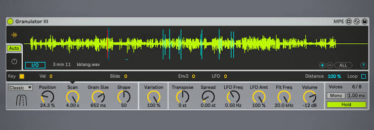

Chapter 11

# Ableton Granulator III

Granulator III was written by Robert Henke, the very person who created the first Granulator, together with the Ableton team: Marco Tonni (interface, implementation, project management), Eric Carl and Kostya Kazhev (interface design). It is the third instrument in the series, and Henke calls it completely new. Henke lists the main points: full MPE support, an extended modulation matrix, a simplified interface, sound capture right into the instrument without extra devices, and a monophonic mode.

!!! note "About the version"

    Granulator III keeps being updated together with Live, so in newer versions the details may differ from those described.

**What you need to run it.** Henke writes that the instrument needs Live 12 Suite, and is downloaded from your account on ableton.com. The pack page on the Ableton site gives wider requirements: Live 12 Standard with Max for Live, version 12.0 or newer. The pack includes 59 presets, a Live set and a selection of samples suitable for granulating. The old Granulator II is still available, but according to Henke it most likely won't be updated any more.

**Installation.** In the Live browser open the Packs section, find Granulator III among the available packs (Available Packs) and install it. After installation it will appear in the Packs section at the top of the browser.

**Push 3 Standalone.** The instrument works there too, but with limitations: there is no picture of the waveform, samples can't be replaced from Push itself (you can only play presets made in Live), and sound capture doesn't work.

<figure markdown="span">
  
  <figcaption>Screenshot 11.1. Granulator III with a loaded sound, Classic mode. Granulator III interface, © Ableton.</figcaption>
</figure>

## The layout of the interface

The interface consists of three zones.

- **Main display.** Shows either the sample (with marks for the grain start, the current position and the grain size, plus the capture controls), or the two envelopes, the LFO and the filter.
- **Modulation display.** Under the main one. Shows the modulations of the selected main parameter, and a small triangle points to which one it is. The set of modulations differs between parameters: this way the engine works more economically, and each connection can be fitted more exactly.
- **Parameter display.** The main knobs.

You can switch the main display with the **Display Selector** buttons on the left or with the **Auto** mode. In Auto, a click on any parameter to the left of **Variation** shows the sample, a click to the right shows the envelopes. A stereo sample is shown in the picture by the left channel only. The **(+)** and **(−)** buttons at the bottom right zoom the waveform in and out around Position, and **(ALL)** returns the whole file.

## Loading a sound

Drag the spoon onto the instrument from the Live browser, from Session or from Arrangement. This works even when the main display shows the envelopes; there just won't be a picture.

On loading and on capture the sound is normalized: the loudest spot is raised to 0 dB. A quiet recording of the spoon will sound at full strength without any extra steps.

## Where the Part 2 parameters are

| Parameter from Part 2 | Where in Granulator III |
| --- | --- |
| Position (chapter 4) | **Position**, in percent, or a click on the waveform |
| Scan (chapter 4) | **Scan**: a position ramp from the note press |
| Position spread (chapter 4) | **Variation** → Position |
| Live input (chapter 4) | **Capture** |
| Size (chapter 5) | **Grain Size**, from 2 ms to 2 s |
| Envelope (chapter 5) | **Shape**, with its own behavior in each mode |
| Density (chapter 6) | in Classic set by the grain size, in Cloud by the **Density** knob |
| Pitch (chapter 7) | **Transpose** and **Tune** |
| Direction (chapter 7) | **Reverse** in Loop mode |
| Pitch spread (chapter 7) | **Variation** → Transpose, Cloud only |
| Pan (chapter 8) | **Spread** |
| Volume spread (chapter 8) | **Variation** → Volume |
| Voices (chapter 8) | 8 voices, mono mode, **Glide**, **Hold** |

## Three grain modes

This is the first thing to choose: the mode determines how Grain Size, Shape and Variation work.

**Classic.** Based on Granulator II, the most flexible and expressive. Two overlapping grains per stereo channel with a very flexible envelope. Density isn't set by a separate knob here: the shorter the grains, the more often they come. According to Henke, a 2 ms grain means a thousand or more overlapping grains per second, and the sound turns into noise or a high tone. This is the synchronous stream from [chapter 6](../chast-2-parametry/06-plotnost-i-sinkhronnost.md).

**Loop.** The closest to an ordinary sampler: playback with crossfades and random modulation of position. It can play long pieces of the source unchanged. Suitable for rhythmic material.

**Cloud.** Layers of up to 20 unsynchronized grains. Henke singles it out for dense monophonic textures. This is the asynchronous cloud from [chapter 2](../chast-1-zerno/02-anatomiya-zerna.md).

## Position

Position decides which section of the sample each grain plays. The scale is in percent, so the position is kept relative to the file: load another sample, and the position stays, say, at a third. It is set with the knob or by clicking right on the waveform.

Position is modulated by the LFO, Envelope 2, the note number (**Key**), key velocity (**Vel**) and all three MPE parameters. Plus per-grain randomness via Variation.

## Scan

In Granulator III scan works differently than in Serum. It is a ramp that moves the position from the moment a note is pressed.

- **Loop off.** The ramp stops at the end point.
- **Loop on.** Having reached the end, the ramp starts again.
- **Distance.** The end point is set as a distance from Position.

If Position plus the current scan value goes past 100%, the position wraps around to the start of the file. Henke recommends this for rhythmic loops.

The scan speed can depend on Key, Velocity and MPE Slide, and is modulated by Envelope 2 and the LFO. With **Key** on, the scan speed grows with the pitch of the note, and on every note the scan ratio is the same. With it off, the speed is the same on all notes. Henke advises playing a chord and switching Key back and forth: the difference is audible at once.

Together with Transpose and Grain Size, scan gives time stretching, pitch shifting and complex time distortions.

The scan scale works as a speed multiplier. At 0 the position stands still, at 1 the cursor moves at the speed of the sample itself, at 0.25 four times slower, and the sound turns into a texture. So the stretching formula from [chapter 4](../chast-2-parametry/04-istochnik-i-poziciya.md) works directly here: s equals the Scan value.

## Grain Size

The main parameter of the engine. A grain ranges from 2 ms to 2 s. At 2 ms the sound is noisy, or high and tonal; at 2 s long pieces of the source are read before the next grain begins.

Grain Size depends on Key, Velocity, MPE Slide and Press, is modulated by the LFO and Envelope 2, and Variation adds randomness to the size of each grain. When the size is being modulated, the new value doesn't take effect at once: the instrument tries to play out the current grain first, to avoid clicks. Exactly how depends on the mode.

A subtlety that both video tutorials warn about: Grain Size measures a piece of the sample, while the audible length of the grain depends on the reading speed. The higher the note, the faster the sample is read and the shorter the same grain sounds. In the second tutorial a 76.1 ms grain at a transposition of +12 semitones sounds half as long.

Grain Size has no tempo sync. A workaround from the second tutorial: calculate the beat length in milliseconds and type it in by hand. A quarter note lasts 60,000 / BPM milliseconds: at 120 BPM that is 500 ms, an eighth 250 ms. The grain lands exactly on the beat when the transposition is at zero and the link of Transpose to the keys is off (more on that below).

Two mode knobs live in this same section:

- **Reverse** (Loop only). The probability that a grain plays backwards. 100% means all grains are reversed.
- **Density** (Cloud only). How many grains sound at once: up to 20 per stereo channel per note.

## Shape

Shape is the grain envelope, and in each mode it is different.

- **Classic.** One knob runs through the whole range from [chapter 5](../chast-2-parametry/05-razmer-i-ogibayushchaya.md): from a sharp attack with an exponential decay (percussive), through a smooth crossfade (bell), to an exponential rise with a sharp cutoff (reverse percussive).
- **Loop.** Shape sets the length of the crossfade at the start and the end of the grain. Zero means a loop without a crossfade, 100% means the fade runs all the time.
- **Cloud.** The shape can't be adjusted, which saves processor power.

Shape is modulated by MPE Slide and Press, the LFO and Envelope 2. An important detail: the shape is calculated at the start of each new grain. So long grains plus a fast even LFO on Shape give complex rhythmic textures: each grain gets its own shape. The turquoise running lines on the waveform show how the shape acts on the grains right now.

## Variation

Variation is responsible for per-grain randomness. The common knob sets how much randomness there is at all, and the separate parameters decide what it touches: **Position**, **Grain Size**, **Transpose** and **Volume**. Henke describes what comes out: static loops come alive, on small grains the sound becomes noisy, rhythmic loops crumble into granular madness.

Select the Variation knob, and orange target knobs appear on the modulation display. By default only Position is raised. Transpose is abbreviated there as TR.

Subtleties worth knowing:

- **Position spread is absolute:** from zero to two seconds, regardless of the sample length. And always positive: the grains jump only forwards.
- **The other spreads are two-sided.**
- **Pitch spread works only in Cloud mode for now**, and negative values have no effect. Henke writes that this may change in updates.

Variation is modulated by MPE Slide and Press, the LFO, Envelope 2, Key and Velocity. For example, velocity on Variation: quiet notes are clean, loud ones crumble.

## Transpose, Tune and the subtleties of tuning

**Transpose** sets the overall tuning of the grains, **Tune** the fine adjustment. Usually pitch follows the notes with **Key** at 100%, but the amount can be changed. Pitch is modulated by Note Pitch Bend, MPE Press, Envelope 2, the LFO and a random value at the moment of the note press. The per-grain pitch spread is duplicated here for convenience.

**The tuning of the sample.** Granulator, like any sampler, assumes that the loaded file is pitched at C. Press C, and the sample plays at its original speed. If the spoon sounds at E, lower Transpose by −4 semitones and fine-tune with Tune. The easiest way to find the spoon's note is with a tuner: put Live's Tuner right after Granulator III and play C.

**One pitch on all keys.** For drones and slicing, transposition by keys often gets in the way. Select Transpose, and on the modulation display set Key to 0: all notes will sound at one pitch. The same Key link at 100% is set on the filter frequency, and it too is worth zeroing, otherwise the filter will travel with every note. Pitch bend still moves the pitch, and it can be drawn as automation in a clip.

Henke explains tuning separately, and it is worth retelling. On the C3 key, a sample plays at its original speed. If the sample is pitched at C3, everything is simple. If C#3, lower it by a semitone. But in granular synthesis short pieces are repeated very often, and the audible pitch becomes a strange mix of the pitch of the source and the grain size. It can't be predicted in a simple way, you have to try. The knobs you need are in the Transpose and Grain Size sections.

**Henke's trick: pitch from grain size.** Set **Transpose Key** to 0 and **Grain Size Key** to 100. Now all notes play the sample at one pitch, but the grain size changes with the note, and a distinct sense of pitch is born. To land in tune, Henke advises a size of exactly 3.822 ms. The number isn't random: a period of 3.822 ms corresponds to a frequency of about 261.6 Hz, middle C (in Live it is called C3). This is a direct demonstration of [chapter 6](../chast-2-parametry/06-plotnost-i-sinkhronnost.md): a note is born from the grain rate.

**MPE and microtonality.** If you work with tonal material and want the instrument to respond correctly to MPE pitch bend and Live 12's tunings, set **Note Pitch Bend** in the Transpose section to 48 semitones.

## Spread

Spread detunes the left and right channels of the grains. Even a small value gives a stereo chorus, but the main point is something else: the left and right grains stop coinciding in start time, and all the Variation spreads get different values in the channels. The sound becomes very stereophonic. Large values give a noticeably different pitch on the left and right. Spread is modulated by Velocity, MPE Slide and Pressure, Envelope 2 and the LFO.

## LFO

A stereo LFO with three ways of working:

- **tempo-synced:** from 1/16 to 2 bars;
- **free:** from 0.01 to 20 Hz;
- **in the audio range:** for FM-like effects and complex noises. This is the audio-rate modulation from the box in [chapter 9](../chast-2-parametry/09-modulyaciya.md).

Shapes: Sine, Triangle, Up, Down, Rect, Sample & Hold (random steps) and two kinds of smooth randomness, Rand and Move. The shape is chosen from the menu or by clicking the shape icon. The LFO starts from a set phase (**Phase**) or from a random one.

- **Stereo.** The phase shift between channels: 0° (mono), 90° (the channels move out of step, Henke calls this "completely out of phase"), 180° (inverted mono).
- **LFO frequency** is modulated by Note Pitch Bend and Slide, Envelope 2, Key, Velocity and a random value at the note press.
- **LFO depth** is modulated by Slide and Pressure, Envelope 2, Key and Velocity. The **Use Mod Wheel** option adds scaling by the modulation wheel. Henke gives MIDI CC 2, though by the MIDI standard the modulation wheel is CC 1.
- **Quant.** Quantizes the LFO output before the depth adjustment and makes stepped modulation. Henke's example: with Quant 0.5 a ramp gives three values (0; 0.5; 1), and a sine five (from −1 to 1 in steps of 0.5). The difference is because the Up and Down ramps are unipolar (from 0 to 1), while the other shapes are bipolar (from −1 to 1).

The Stereo knob works especially well on Position and Grain Size: with a phase shift the LFO moves position and grain size differently in the left and right ear, and the cloud splits into two.

## Filter

Two SVF filters in series, nine modes: 24 dB LP, 12 dB LP, 12 dB LP into 12 dB HP, 12 dB LP with a notch, a single notch, two notches, 12 dB HP with a notch, 12 dB HP, 24 dB HP. A click on the icon flips through the types. The filter can be switched off to save processor power.

- **Width.** In all modes except 12 dB LP, 12 dB Notch and 12 dB HP, shifts the frequency of the second filter. Negative values are usually useful: for example, in the LP and notch pair the notch works only if it is below the LP cutoff.
- **Resonance.** In the dual modes acts only on the main filter, for the second it is fixed.
- **Frequency modulation:** all three MPE parameters, the volume envelope and Envelope 2, Key, Velocity and the LFO.

By default the filter frequency is tied to Key at 100%: the filter travels with the transposition and keeps removing or emphasizing the same harmonics of the source on any note.

## Volume and envelopes

Volume is modulated by Key, Velocity, MPE Slide and Press and the LFO. The per-grain volume spread is duplicated here.

There are two envelopes. **Envelope 1** controls volume and can move the filter frequency. **Envelope 2** is a general source for a multitude of parameters. Both have very long attack, decay and release, for slowly changing sounds. Each has its own **Key** parameter: the envelope's speed depends on the pitch of the note, and high notes can die away faster, as with acoustic instruments.

A trick from the second tutorial: Envelope 2 with a decay of about a second and negative depth straight onto Shape and Grain Size. At the attack of the note the grains are sharp and small, then return to normal. The sound gets a click at the start, like plucked instruments.

## Voices, Glide and Hold

- **Polyphony** is fixed, 8 voices.
- **Mono mode.** In it **Glide** acts on all modulations at once, and notes flow smoothly into each other. Glide works only on overlapping notes, with a time from 0 to 2 seconds.
- **Hold.** Holds the last played notes, as in an arpeggiator. You play a chord, release the keys and turn the knobs with both hands. A new note after all the keys have been fully released clears the held ones. In Granulator II Hold worked differently.

## Capture: live input

Capture turns Granulator III into a live-sound granulator.

1. Switch on capture with the **I/O** button. The sample doesn't change yet, only the recording interface appears.
2. Choose a source with the two **Source** menus. You can even take the output of Granulator III itself and resample yourself.
3. The instrument constantly records the last few seconds of sound; how many is set by the **Length** menu.
4. Press **Capture**: the current sample is replaced by a snapshot of the last seconds. The knob settings don't change.
5. **Cancel** returns the last loaded sample, even if you pressed Capture many times.
6. **Save** opens a save dialog: the instrument will write the file and reload it as an ordinary sample.

Important: an unsaved capture will vanish the next time the project is opened, and the last loaded sample will be loaded in its place.

The capture source can be another Live track or an external input: a microphone, a hardware synthesizer. The second Source menu chooses the point where the signal is taken, and in the second tutorial the signal after effects is chosen.

**Generative resampling** (second tutorial). Granulator III sits on its own track and captures a neighboring track with drums. An LFO device in square mode is assigned to the Capture button and presses it every two bars, so the granulator updates its material by itself. At Scan 1 the captured sound is almost unchanged, at Scan 0.25 it turns into a texture. Add an LFO to Grain Size and Shape, and you get an instrument for live performance that feeds itself.

## Spoon recipes

A tip from the first tutorial: set the knobs on one sample, and then swap samples and listen. The sound is largely decided by the source, and one setting on different files gives quite different results.

!!! success "Recipe 11.1. A pad in Classic"

    1. Classic mode. Position at the middle of the ring.
    2. Grain Size about 100 ms, Shape in the middle (a smooth crossfade).
    3. Variation a little, on Position.
    4. Spread just a touch, for stereo.
    5. Envelope 1: attack 2 seconds, release 4 seconds. Switch on Hold, play a chord and release the keys.

!!! success "Recipe 11.2. The spoon synthesizer"

    1. Classic mode, Position on the ring.
    2. Transpose Key 0, Grain Size Key 100, Grain Size 3.822 ms.
    3. Play a melody: the pitch is set by the grain size, and the color by the spoon's ring.
    4. Add a little Variation on Grain Size, and the tone becomes rough.

!!! success "Recipe 11.3. Ragged rhythm in Loop"

    1. Loop mode. Grain Size 100–200 ms.
    2. Reverse 30%.
    3. LFO in tempo mode, Sample & Hold shape, 1/16, on Position.
    4. Shape lower, so the crossfades don't smear the attacks.

!!! success "Recipe 11.4. A cloud in Cloud"

    1. Cloud mode. Density about 12.
    2. Grain Size 150–300 ms.
    3. Variation noticeable: Position at 300–500 ms, Transpose at a couple of semitones.
    4. Spread higher. A reverb with a long tail on top.

!!! success "Recipe 11.5. Slicing across the keys"

    1. Load a long sound: a phrase, a field recording, a session of improvisation with a synth.
    2. Transpose Key at 0, the filter frequency's Key at 0.
    3. Select Position and on the modulation display raise Key. Now each key takes its own piece of the sample. Similar to slicing in Simpler, but not tied to transients. How far the position shifts per key can't be told from the scale: adjust by ear.
    4. Switch on mono and Glide. When playing legato the position will drift from piece to piece.
    5. Cloud mode and a smaller Grain Size: the position change becomes audible sooner.

## Exercise 11.1. A granulator of your own voice { .exercise }

1. Switch on I/O, and in Source choose an input with a microphone.
2. Say "spoon" into the microphone several times, drawing out the vowel.
3. Press Capture. If you didn't like it, speak again and press Capture once more.
4. Switch on Scan with Loop, Distance at the length of one word. Hold, one note.
5. Save a successful capture with the Save button, otherwise it will vanish.

## Sources for this chapter

- [Granulator III, Robert Henke's page](https://www.roberthenke.com/technology/granulator3.html): all parameters, modes, Capture, Push limitations, the team.
- [Granulator III, the pack page on ableton.com](https://www.ableton.com/en/packs/granulator-iii/): Live version requirements, the contents of the pack.
- [Video tutorial 1](https://youtu.be/PqSFu6by6Kk): installation, sample tuning through a tuner, the behavior of Shape in Classic, Capture.
- [Video tutorial 2](https://youtu.be/ZVLM1XMT6Z0): Scan as a speed multiplier, Grain Size and transposition, calculating grain length for tempo, Position with Key, the Envelope 2 trick, generative resampling. The video was made with Ableton sponsorship.
