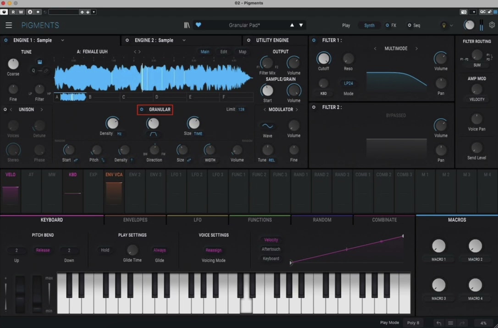

Chapter 12

# Arturia Pigments

In Pigments the granulator is built into the Sample engine. The synthesizer has two main engine slots, and each can hold one of five types: Analog, Wavetable, Sample, Harmonic and Modal. Put Sample in both slots and you get two independent granulators in one patch. The granular mode appeared as far back as the second version of Pigments, together with MPE support.

!!! note "About the version"

    The description corresponds to Pigments 7.0.0. Ranges marked "per the Pigments 2 manual" are taken from the documentation of the second version and may have changed in newer versions.

<figure markdown="span">
  
  <figcaption>Screenshot 12.1. The Sample engine in Main mode, the granular section on. Pigments interface, © Arturia.</figcaption>
</figure>

## Loading a sound

The Sample engine has six sample slots, A–F, and their previews are visible under the waveform picture. A click on the preview of an empty slot opens the sample browser.

Your own sound gets into Pigments through a folder. In the sample browser press **Add Folder** at the bottom right and point to the folder with the spoon. The folder will appear in the left column of the browser next to the factory banks. Formats: WAV or AIFF, 16 or 24 bit, from 44.1 to 192 kHz. The sample length is limited only by RAM.

In the browser you can listen to samples before loading: the headphones icon at the top of the right column switches on auditioning, and the knob next to it sets its volume. A single click selects a sample and leaves the browser open, a double click loads it and closes the browser.

## Three display views

Above the waveform there are three buttons:

- **Main.** Under the waveform you see the granular section. Only the stretch between the trim markers is shown.
- **Edit.** The tuning, direction, loop and volume of the slot. The trim markers are set here too.
- **Map.** How the samples from the six slots are laid out across the keys and velocity.

## Where the Part 2 parameters are

| Parameter from Part 2 | Where in Pigments |
| --- | --- |
| Reading window (chapter 4) | the trim markers Trim Start and Trim Stop in Edit mode |
| Position (chapter 4) | the **Start** knob in the Sample/Grain section, the blue line on the waveform |
| Scan (chapter 4) | the **Scan** knob |
| Position spread (chapter 4) | the **Start** randomizer |
| Size (chapter 5) | the **Size** knob and its modes |
| Envelope (chapter 5) | the **Shape** knob and the shape menu |
| Density (chapter 6) | the **Density** knob, Hertz or tempo mode |
| Density spread, synchronicity (chapter 6) | the **Density** randomizer |
| Pitch (chapter 7) | the engine's Tune section and the slot's Transpose |
| Pitch spread, direction (chapter 7) | the **Pitch** and **Direction** randomizers |
| Pan, volume (chapter 8) | the **Stereo** and **Volume** randomizers |
| Grain limit (chapter 8) | the **Limit** field in the section header |

## Switching on the granular mode

In Main mode under the waveform there is the **Granular** section with an on button in its header. While it is off, the engine works as an ordinary sampler. On the right of the header is the **Limit** field: the maximum number of simultaneously overlapping grains. The Pigments 7 manual calls it one of the main ways to keep the processor in check at high density. Per the Pigments 2 manual, the limit is set from 3 to 256.

The top row of knobs sets the main things in the grains, the bottom row scatters them at random.

## Start: position

In Pigments, position lives next to the granular section, in the **Sample/Grain** section. The **Start** knob sets the point from which the sample plays or the grains are born, within the limits between the trim markers. On the waveform it is a vertical blue line. The **Volume** knob is there too: the volume of the sample or grain.

The neighbouring **Output** section is responsible for the engine as a whole: the overall volume and **Filter Mix**, the distribution of the signal between filters 1 and 2.

## Scan

Scan moves the "head" through the stream of grains. The manual gives reference points:

- **12 o'clock:** no scan, freeze.
- **Plus:** the start point moves forward in time.
- **Minus:** backwards.
- **±100%:** the scan speed equals the playback speed of the grains. Other percentages speed up or slow down the scan relative to that speed.

The stretching formula from [chapter 4](../chast-2-parametry/04-istochnik-i-poziciya.md) works if you take 100% as the original speed. The manual advises not to guess but to listen.

## Density

Density sets the rate at which grains are born. A click on the blue oval under the knob opens the **Density Type** menu: **Hertz** (free, in hertz) and tempo options: **Sync**, **Straight only**, **Triplets only**, **Dotted only**. In Hertz mode the number on the knob is simply grains per second: 1 Hz means one grain a second.

A tip from the manual: learn at low density, where it is easier to hear what is going on.

## Shape: the grain envelope

A click on the shape icon above the third knob opens the **Grain Envelope Shape** menu: Triangle, Trapezoid, Tukey, Gaussian, Sinc, Expodec, Rexpodec, Smooth Exp. The menu chooses the shape, and the **Shape** knob bends it further. Per the Pigments 2 manual, the knob moves the shape from "smooth" to "clicking", and it can be modulated.

| Shape | How it is built | Chapter 5 |
| --- | --- | --- |
| Triangle | a straight rise, a straight fall | triangle |
| Trapezoid | a rise, a shelf, a fall | trapezoid |
| Tukey | a flat middle, rounded edges | trapezoid with soft edges |
| Gaussian | a bell | Gauss |
| Sinc | a sharp centre, oscillating tails | a special colour |
| Expodec | a sharp attack, an exponential decay | percussive |
| Rexpodec | an exponential rise, a sharp end | reverse percussive |
| Smooth Exp. | a smoothed exponential | soft percussive |

The difference between the shapes is most audible on short grains: compare them by ear at a length of 10–30 ms.

## Size: grain length

The menu under the Size knob chooses what it is measured in:

- **Percentage.** A percentage of the maximum grain size.
- **Time Division.** A fraction of the period of the current density. This is the overlap from [chapter 2](../chast-1-zerno/02-anatomiya-zerna.md): the grain length is tied to the distance between grains, and the character of the cloud is kept at any density.
- **Straight Only**, **Triplets Only**, **Dotted Only.** By tempo: even divisions, triplets, dotted.
- **Time.** Absolute time in milliseconds. Per the Pigments 2 manual, from 1 ms to 1 second.

The manual reminds you separately: grains overlap, and that is an important part of the granular character. How many of them overlap at most is decided by Limit.

## Randomizers

The bottom row of knobs adds randomness. Most have a direction menu: a button or an icon next to the knob.

| Knob | What it scatters | Menu options | Chapter |
| --- | --- | --- | --- |
| Start | position: grains are born before, after or around the start point | Before, After, Both | 4 |
| Pitch | grain pitch; per the Pigments 2 manual, up to 3 octaves | Up, Down, Both | 7 |
| Density | density: adds or removes grains | More Dense, Less Dense | 6 |
| Direction | the share of reversed grains | none | 7 |
| Size | grain length | Shorter, Longer, Both | 5 |
| Stereo | pan | Pan, Width | 8 |
| Volume | grain volume | none | 8 |

Two subtleties:

- **Direction**, per the Pigments 2 manual: the far right position plays grains forwards, the far left backwards, the middle gives fifty-fifty.
- **Stereo in Width mode** spreads grains that are already randomized across the stereo field. If there are no other spreads, all grains stay in the centre even with Width at maximum. The Pigments 2 manual clarifies: Width adds a difference between the left and right channels for the Size, Pitch and Start spreads. So Width works only in a pair with other randomizers.

## Six samples and grains

Here is a possibility that the other two instruments in the book don't have. The **Map** mode lays out slots A–F, and two of its options work grain by grain:

- **Round Robin.** The slots play in a circle. With the granular section on, each new grain is taken from the next sample.
- **Random.** The sample is chosen at random. With the granular section on, each grain is taken from a random slot.

Load six different recordings into the six slots, and the cloud will weave them together grain by grain. The other Map modes: **Single** (one sample across the whole keyboard), **Key Map** (slots laid out across the keyboard), **Key/Velo Map** (by keys and two velocity layers), **Sample Pick** (the sample is chosen by a knob, which can be modulated).

## Edit mode: tuning and markers

Choose a slot with the A–F button and set:

- **Tune.** **Transpose** ±36 semitones, **Fine** ±1 semitone in steps of a cent, **Root Note** (the sample's root note).
- **Playback.** **Play Mode**: forwards (Normal) or backwards (Reverse). **Loop** switches the loop on, **Loop Mode** chooses forwards (Forward) or a pendulum (F&B), **Loop Fade** makes a loop crossfade (Forward only), the **r** button keeps the loop going on note release.
- **Mix.** **Gain** and **Pan** of the slot.
- **Slot.** **Copy** copies the sample into another slot so you can keep it with different settings. **Reset** resets the slot, **Clear** empties it.

The trim markers (Trim Start and Trim Stop) are vertical lines with triangular handles on top, the loop markers have handles at the bottom. This is the reading window from [chapter 4](../chast-2-parametry/04-istochnik-i-poziciya.md): lock the spoon into the ring. The **Snap** button above the display magnetizes the markers to the waveform's zero crossings and saves you from clicks. For stereo samples the tolerance is wider, because they may have no exact zeros.

Root Note will pick itself up if the root note is written in the WAV file's metadata. Trim and loop markers are also taken from metadata, if there are any.

## The engine's Tune and the sample filter

The engine's Tune section sets the overall tuning of the voices. For the Sample engine it has a **Filter** knob: a filter right on the sample, ahead of all the other processing. Left of 12 o'clock it lowers the cutoff of a low-pass filter, right of it raises the cutoff of a high-pass filter, at 12 o'clock there is no filter. Handy for cutting the spoon's rumble or hiss before the granulator.

## Unison and Shaper

Under the Tune section sits the Unison/Shaper section. A click on its name opens the modes menu.

- **Unison, Chord, Super.** Work the same way as in other engines. In Chord mode the unison voices are quantized by semitones to one of 12 classic chords: one key gives a cloud of a chord. For the analog engine the manual gives up to 8 unison voices.
- **Resonator.** Six parallel band-pass filters, the first tuned by the note and the Tune section, the rest to harmonics of it. In granular mode the resonator follows the pitch of the grains, even with random pitch. Knobs: **Coarse** (tuning), **Wet/Dry**, **Resonance** (resonance and ring length), **Inharm**: at zero the resonators sit on harmonics, above zero they spread apart, below zero they come together. An inharmonic tuning gives bells and metal.
- **BitCrush.** **Decimate** (sample-rate reduction), **Bit Depth**, **Key Track** (Decimate follows the key).
- **Modulation.** **Freq Mod** (linear through-zero FM) and **Ring Mod**. The modulation source: the engine's modulator oscillator or another main engine.

## Modulation

Modulation is assigned by dragging. In the modulation overview strip, hover over a source's name and it changes to **Assign**. Drag it onto the knob you need: all valid targets are outlined in grey. Then you change the depth on the ring around the knob.

Sources by tab:

- **Keyboard:** velocity, aftertouch, keyboard tracking, wheels.
- **Envelopes:** three envelopes, the first always on volume. All Pigments envelopes, per the manual, can work at audio rate.
- **LFO:** three.
- **Functions:** three multipoint functions, complex curves of any shape.
- **Random:** three generators with the modes Random, Voice Modulator, Turing, Sample & Hold, Binary.
- **Combinate:** mix other sources.
- **Macros:** four macros M1–M4.

The main granular feature of modulation: for LFOs and Functions the restart menu (Retrig Source) has the items **Engine 1 Grain** and **Engine 2 Grain**. They appear when the slot holds a Sample engine with the granular section on. An LFO restarted by each grain gives every grain its own modulation curve. Hang such a Function on the filter, and each grain will get its own filter decay.

## Bonus: the Modal granular exciter

In the Modal engine, a physical model of resonating objects, there is a Friction exciter with a **Granular** mode. It takes some of the Sample granulator's settings with fixed values and strikes the resonator with grains. You choose the type of source sample, the volume (**Volume**), the pitch shift (**Tune**) and the grain rate (**Rate**, in hertz or by tempo). The manual advises modulating Rate through an LFO, Function or Random. A whole synthesizer is built on this principle: Kaivo by Madrona Labs, where the granulator works as the performer's "touch" and excites physical models of resonators and a common body ([madronalabs.com](https://madronalabs.com/products/kaivo)).

## Recipes on the spoon

Everywhere: the Sample engine in slot 1, the spoon loaded through Add Folder, Main mode, the granular section on, the trim markers on the ring.

!!! success "Recipe 12.1. Pad"

    1. Start at the middle of the ring. Scan slightly right of 12 o'clock.
    2. Density in Hertz mode, about 30.
    3. Size in Time mode, about 120 ms. Gaussian shape.
    4. Randomizers: Start (Both) a little, Pitch (Both) just a touch, Stereo (Pan) at half, Volume a little.
    5. Envelope 1: a long attack, a long release.

!!! success "Recipe 12.2. Drops"

    1. Density in Hertz mode, 3–6.
    2. Size in Time mode, 20–40 ms. Expodec shape.
    3. Randomizers: Start (Both) strongly, Density (Less Dense) noticeably, Volume noticeably.

!!! success "Recipe 12.3. Bells"

    1. The pad from recipe 12.1.
    2. In Unison/Shaper choose Resonator, Wet/Dry in the middle.
    3. Raise Resonance for a long ring.
    4. Move Inharm up: the spoon will sound like bells. The Pitch randomizer will be picked up by the resonator.

!!! success "Recipe 12.4. Six spoons"

    1. Record five more sounds: the spoon on a glass, on a saucepan, on a table, on a bottle, on a windowsill.
    2. Load all six into slots A–F.
    3. In Map mode choose Random.
    4. Switch on the granular section: each grain is taken from a random recording, and the cloud becomes a kitchen.

!!! success "Recipe 12.5. A grain with its own filter"

    1. Density by tempo, Straight only, 1/16. Size in Time Division mode.
    2. Function 1: a short decay from maximum to zero. Retrig Source: Engine 1 Grain.
    3. Assign Function 1 to the frequency of filter 1.
    4. Each grain gets its own filter sweep, and the even grid of sixteenths starts to quack.

## Exercise 12.1. One setting, six slots { .exercise }

1. Build recipe 12.1 on the spoon.
2. With the Copy button duplicate the spoon into slots B and C, and in each change Transpose: zero, plus a fifth, plus an octave.
3. Map mode: Round Robin. The grains will take the three transpositions of one sound in turn.
4. Compare with Random mode. Record both versions and listen to them one after another.

## Sources for this chapter

- The Pigments 7 manual, Arturia (product version 7.0.0, revision of 15 December 2025): chapter 9 on the Sample engine (pp. 105–121), section 11.4.3 on the granular exciter (pp. 142–143), chapters 19–20 on modulation, section 7.2 on unison modes, section 1.1.2 on the structure of the synthesizer.
- The Pigments 2 manual, Arturia: section 5.4.7 Granular Section (pp. 77–78): the ranges of Limit, Size and Pitch, the behaviour of Direction and Width.
