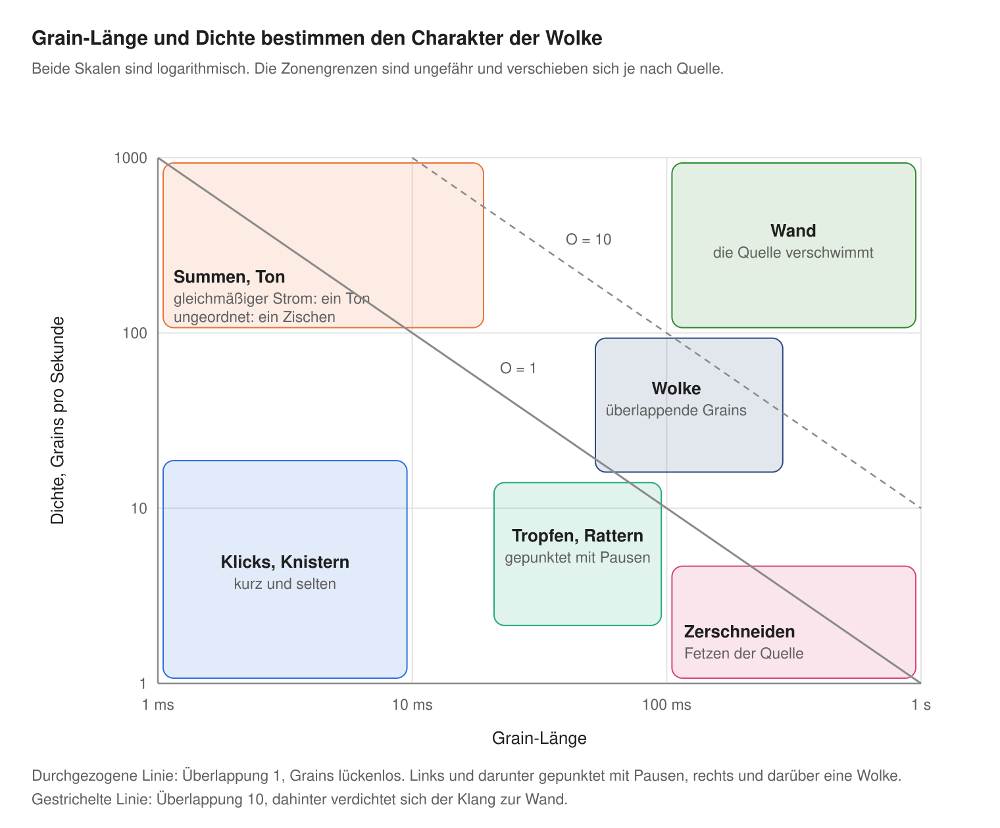
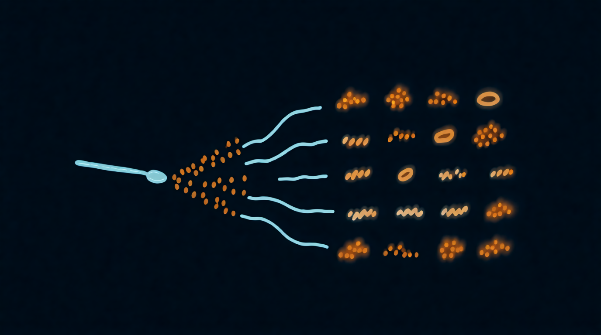

Kapitel 13

# Die Klangkarte und zwanzig Instrumente aus einem Löffel

Am Anfang des Buchs stand ein Versprechen: Aus drei Sekunden Löffelklingen sollen zwanzig ganz verschiedene Instrumente wachsen. Zeit, es einzulösen. Zuerst eine Karte, die den ganzen Raum auf einen Blick zeigt.

## Die Klangkarte

Zwei Regler bestimmen den Charakter des Granularklangs stärker als alle anderen: Grain-Länge und Dichte. Trag sie auf den Achsen ab, und der Raum zerfällt in Zonen.

<figure markdown="span">
  
  <figcaption>Die Klangkarte: Grain-Länge und Dichte.</figcaption>
</figure>

Die Linien auf der Karte sind die Überlappung aus [Kapitel 2](../chast-1-zerno/02-anatomiya-zerna.md), O = Länge × Dichte. Alles links und unterhalb der durchgezogenen Linie klingt gepunktet: Die Grains folgen mit Pausen. Alles rechts und darüber verschmilzt zu einer Wolke, und jenseits der gestrichelten Linie verdichtet sich die Wolke zur Wand. Die Tonzone oben links folgt den Regeln aus [Kapitel 6](../chast-2-parametry/06-plotnost-i-sinkhronnost.md): Ein gleichmäßiger Strom kurzer Grains ergibt einen Ton, ein ungleichmäßiger ein Zischen.

So nutzt du die Karte. Fang in der Mitte der Wolke an: ein Grain von etwa 100 ms, 30 Grains pro Sekunde. Das ist ein sicherer Punkt, an dem fast jede Quelle schön klingt. Bewege dann einen einzigen Regler und schau, in welche Zone du geraten bist. Die übrigen Regler (Position, Tonhöhe, Streuungen, Fenster) ändern die Farbe innerhalb einer Zone, führen aber selten aus ihr heraus.

## Zwanzig Instrumente

<figure markdown="span">
  
  <figcaption>Illustration 13.1. Ein Löffel, zwanzig Instrumente.</figcaption>
</figure>

Die Quelle ist überall dieselbe: ein Löffel gegen eine Tasse. Die Parameter sind in den Begriffen aus [Teil 2](../chast-2-parametry/index.md) angegeben, und rechts steht, wo sich dieser Klang am leichtesten bauen lässt und in welchem Rezept er schon behandelt wurde.

| # | Klang | So entsteht er | Am leichtesten in |
| --- | --- | --- | --- |
| 1 | Eisiges Pad | Position im Klingen, Grain 100–150 ms, Wolke, Glockenfenster, etwas Positions- und Tonhöhenstreuung, langsamer Scan | überall: Rezepte 10.1, 11.1, 12.1 |
| 2 | Ewiges Klingen | Scan auf null, Positionsstreuung 10–30 ms, Grain 80–150 ms | überall: das Einfrieren aus Kapitel 4 |
| 3 | Ein minutenlanger Schlag | Position am Anfang, Scan etwa 5 % der Originalgeschwindigkeit, Grain 80 ms | überall; prüf die Scan-Skala im Kapitel deines Instruments |
| 4 | Schimmernde Orgel | Wolke plus Stimmen in Oktaven und Quinten | Serum: STACK 12+7, Rezept 10.5 |
| 5 | Ein Akkord auf einer Taste | Wolke plus Unison, zu einem Akkord quantisiert | Pigments: Modus Chord |
| 6 | Chor | asynchrone Wolke, Tonhöhenstreuung 10–30 Cent, breites Stereo | Granulator III, Cloud: Rezept 11.4 |
| 7 | Der Löffel-Synthesizer | kurzes Grain im gleichmäßigen Strom, der Ton entsteht aus der Grain-Rate | Granulator III: Rezept 11.2; Serum: DENS im Modus Free |
| 8 | Domglocke | Tonhöhe −24 Halbtöne, lange Grains, langer Hall | überall |
| 9 | Glasstaub | Tonhöhe +24 Halbtöne, Grain 10–20 ms, starke Positions- und Lautstärkestreuung | überall |
| 10 | Metallische Wolke | Wolke plus Frequenzmodulation durch einen zweiten Generator | Serum: Warp FM, Rezept 10.4; Pigments: Freq Mod |
| 11 | Glocken aus dem Resonator | Wolke durch einen Resonator mit inharmonischer Stimmung | Pigments: Resonator, Rezept 12.3 |
| 12 | Tropfen | Grain 20–40 ms, 3–6 Grains pro Sekunde, perkussives Fenster, Positionsstreuung über das ganze Klingen | überall: Rezepte 10.2, 12.2 |
| 13 | Hi-Hat aus dem Anschlag | Position auf dem Anschlag, Grain 5–15 ms, Dichte tempogebunden 1/16, perkussives Fenster, Hochpassfilter | Serum, Pigments: tempogebundene Dichte |
| 14 | Zerschneiden im Raster | Durchlauf des Samples an den Takt gekoppelt, Dichte 1/16, Grain-Länge als Bruchteil der Periode | Serum: Rezept 10.3; Pigments: Time Division |
| 15 | Saugender Rhythmus | das Zerschneiden aus Punkt 14 plus rückwärts laufende Grains auf Befehl | Serum: Reverse Grains; Granulator III: Reverse in Loop |
| 16 | Quakendes Raster | eine eigene Filterhüllkurve auf jedem Grain | Pigments: Rezept 12.5 |
| 17 | Bass | Position im Klingen, Tonhöhe −24…−36 Halbtöne, langes Grain, mono, Glide, Tiefpassfilter | Granulator III: Mono und Glide; überall |
| 18 | Riser | über 4–8 Takte wächst die Dichte, das Grain schrumpft, Tonhöhe und Filter steigen | überall, mit einem Makro |
| 19 | Küche | eine Grain-Wolke aus sechs verschiedenen Aufnahmen | Pigments: Map Random, Rezept 12.4 |
| 20 | Live-Loop | du klopfst mit dem Löffel vor dem Mikrofon, während du spielst, und nimmst den Klang im Flug auf | Granulator III: Capture, Übung 11.1 |

Zwanzig Klänge aus einer Datei, und das ist längst nicht die Grenze: Jede Zeile der Tabelle ist selbst ein Ausgangspunkt für ein Dutzend Varianten.

## Übung 13.1. Dein eigenes Pack { .exercise }

1. Bau alle zwanzig Klänge. Nimm jeden als acht Takte Audio auf.
2. Benenn die Dateien nach der Tabelle: „01 eisiges Pad“, „02 ewiges Klingen“ und so weiter.
3. Nimm eine andere Quelle (deine eigene Stimme, eine knarrende Tür, Straßenlärm) und geh die Tabelle noch einmal durch.
4. Vergleiche die beiden Packs. Die Zeilen, in denen die Quelle den Klang am stärksten verändert hat, zeigen, welche Regler am meisten vom Material abhängen.
