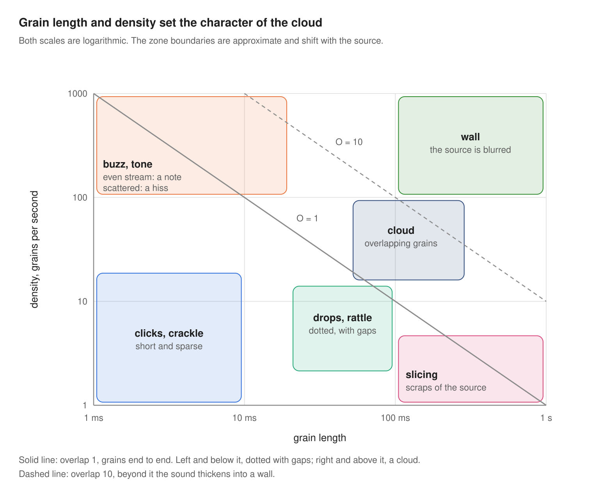

Chapter 13

# The sound map and twenty instruments from one spoon

At the start of the book there was a promise: from three seconds of the spoon's ring, twenty very different instruments would grow. It is time to keep it. First a map that shows the whole space at once.

## The sound map

Two knobs decide the character of granular sound more than all the others: grain length and density. Plot them on the axes, and the space splits into zones.

<figure markdown="span">
  
  <figcaption>The sound map: grain length and density.</figcaption>
</figure>

The lines on the map are the overlap from [chapter 2](../chast-1-zerno/02-anatomiya-zerna.md), O = length × density. Everything to the left of and below the solid line sounds dotted: the grains go with gaps. Everything to the right and above merges into a cloud, and beyond the dashed line the cloud thickens into a wall. The tone zone in the top left corner lives by the rules of [chapter 6](../chast-2-parametry/06-plotnost-i-sinkhronnost.md): an even stream of short grains gives a note, an uneven one gives a hiss.

How to use the map. Start from the middle of the cloud: a grain of about 100 ms, 30 grains a second. This is a safe point where almost any source sounds beautiful. Then move one knob and watch which zone you have gone into. The other knobs (position, pitch, spreads, window) change the colour inside a zone, but rarely take you out of it.

## Twenty instruments

<figure markdown="span">
  
  <figcaption>Illustration 13.1. One spoon, twenty instruments.</figcaption>
</figure>

The source is the same everywhere: a spoon against a cup. The parameters are given in the terms of [Part 2](../chast-2-parametry/index.md), and on the right it is shown where this sound is easiest to build and in which recipe it has already been worked out.

| № | Sound | How to get it | Where it's easiest |
| --- | --- | --- | --- |
| 1 | Icy pad | position on the ring, grain 100–150 ms, cloud, bell window, a little position and pitch spread, slow scan | everywhere: recipes 10.1, 11.1, 12.1 |
| 2 | Eternal ring | scan at zero, position spread 10–30 ms, grain 80–150 ms | everywhere: the freeze from chapter 4 |
| 3 | A hit a minute long | position at the start, scan about 5% of the original speed, grain 80 ms | everywhere, check the scan scale against your instrument's chapter |
| 4 | Shimmering organ | a cloud plus voices at octaves and fifths | Serum: STACK 12+7, recipe 10.5 |
| 5 | A chord on one key | a cloud plus unison quantized into a chord | Pigments: Chord mode |
| 6 | Choir | an asynchronous cloud, pitch spread 10–30 cents, wide stereo | Granulator III, Cloud: recipe 11.4 |
| 7 | The spoon synthesizer | a short grain in an even stream, the note from the grain rate | Granulator III: recipe 11.2; Serum: DENS in Free mode |
| 8 | Cathedral bell | pitch −24 semitones, long grains, a long reverb | everywhere |
| 9 | Glass dust | pitch +24 semitones, grain 10–20 ms, strong position and volume spread | everywhere |
| 10 | Metallic cloud | a cloud plus frequency modulation from a second generator | Serum: Warp FM, recipe 10.4; Pigments: Freq Mod |
| 11 | Bells from a resonator | a cloud through a resonator with an inharmonic tuning | Pigments: Resonator, recipe 12.3 |
| 12 | Drops | grain 20–40 ms, 3–6 grains a second, a percussive window, position spread across the whole ring | everywhere: recipes 10.2, 12.2 |
| 13 | A hi-hat from a knock | position on the attack, grain 5–15 ms, density by tempo 1/16, a percussive window, a high-pass filter | Serum, Pigments: density by tempo |
| 14 | Slicing onto a grid | the sample's pass is tied to the bar, density 1/16, grain length as a fraction of the period | Serum: recipe 10.3; Pigments: Time Division |
| 15 | A sucking rhythm | the slicing from item 14 plus reversed grains on command | Serum: Reverse Grains; Granulator III: Reverse in Loop |
| 16 | A quacking grid | its own filter envelope on each grain | Pigments: recipe 12.5 |
| 17 | Bass | position on the ring, pitch −24…−36 semitones, a long grain, mono, glide, a low-pass filter | Granulator III: mono and Glide; everywhere |
| 18 | Riser | over 4–8 bars the density grows, the grain shrinks, the pitch and filter rise | everywhere, with one macro |
| 19 | Kitchen | a cloud of grains from six different recordings | Pigments: Map Random, recipe 12.4 |
| 20 | A live loop | you tap the spoon on a microphone right while playing and capture the sound on the fly | Granulator III: Capture, exercise 11.1 |

Twenty sounds from one file, and that is far from the limit: each row of the table is itself a starting point for a dozen variations.

## Exercise 13.1. Your own pack { .exercise }

1. Build all twenty sounds. Record each as eight bars of audio.
2. Name the files after the table: "01 icy pad", "02 eternal ring" and so on.
3. Take another source (your own voice, a creaking door, street noise) and go through the table again.
4. Compare the two packs. The rows where the source changed the sound most will show which knobs depend more on the material.
