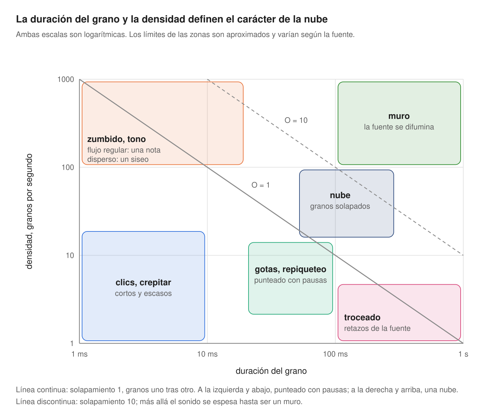

Capítulo 13

# El mapa del sonido y veinte instrumentos de una cucharilla

Al principio del libro había una promesa: de tres segundos de tintineo de una cucharilla crecerían veinte instrumentos muy distintos. Ha llegado el momento de cumplirla. Primero, un mapa que muestra todo el espacio de un vistazo.

## El mapa del sonido

Dos mandos deciden el carácter del sonido granular más que todos los demás: la duración del grano y la densidad. Ponlos en los ejes y el espacio se divide en zonas.

<figure markdown="span">
  
  <figcaption>El mapa del sonido: duración del grano y densidad.</figcaption>
</figure>

Las líneas del mapa son el solapamiento del [capítulo 2](../chast-1-zerno/02-anatomiya-zerna.md), O = duración × densidad. Todo lo que queda a la izquierda y por debajo de la línea continua suena punteado: los granos van con pausas. Todo lo que queda a la derecha y por encima se funde en una nube, y más allá de la línea discontinua la nube se espesa hasta ser un muro. La zona del tono, arriba a la izquierda, sigue las reglas del [capítulo 6](../chast-2-parametry/06-plotnost-i-sinkhronnost.md): un flujo regular de granos cortos da una nota; uno irregular, un siseo.

Cómo usar el mapa. Empieza en el centro de la nube: un grano de unos 100 ms, 30 granos por segundo. Es un punto seguro donde casi cualquier fuente suena bonita. Después mueve un solo mando y mira a qué zona has ido a parar. Los demás mandos (posición, altura, dispersiones, ventana) cambian el color dentro de una zona, pero rara vez te sacan de ella.

## Veinte instrumentos

<figure markdown="span">
  
  <figcaption>Ilustración 13.1. Una cucharilla, veinte instrumentos.</figcaption>
</figure>

La fuente es siempre la misma: una cucharilla contra una taza. Los parámetros se dan en los términos de la [parte 2](../chast-2-parametry/index.md), y a la derecha se indica dónde es más fácil montar ese sonido y en qué receta ya está explicado.

| # | Sonido | Cómo conseguirlo | Dónde es más fácil |
| --- | --- | --- | --- |
| 1 | Pad helado | posición en el tintineo, grano de 100–150 ms, nube, ventana de campana, un poco de dispersión de posición y de altura, escaneo lento | en todos: recetas 10.1, 11.1, 12.1 |
| 2 | Tintineo eterno | escaneo a cero, dispersión de posición de 10–30 ms, grano de 80–150 ms | en todos: la congelación del capítulo 4 |
| 3 | Un golpe de un minuto | posición al principio, escaneo a un 5 % de la velocidad original, grano de 80 ms | en todos; comprueba la escala del escaneo en el capítulo de tu instrumento |
| 4 | Órgano que destella | nube más voces en octavas y quintas | Serum: STACK 12+7, receta 10.5 |
| 5 | Un acorde con una tecla | nube más unísono cuantizado en acorde | Pigments: modo Chord |
| 6 | Coro | nube asíncrona, dispersión de altura de 10–30 cents, estéreo ancho | Granulator III, Cloud: receta 11.4 |
| 7 | La cucharilla-sintetizador | grano corto en flujo regular, la nota sale de la frecuencia de los granos | Granulator III: receta 11.2; Serum: DENS en modo Free |
| 8 | Campana de catedral | altura −24 semitonos, granos largos, reverb larga | en todos |
| 9 | Polvo de cristal | altura +24 semitonos, grano de 10–20 ms, mucha dispersión de posición y de volumen | en todos |
| 10 | Nube metálica | nube más modulación de frecuencia desde un segundo generador | Serum: Warp FM, receta 10.4; Pigments: Freq Mod |
| 11 | Campanas de resonador | nube a través de un resonador con afinación inarmónica | Pigments: Resonator, receta 12.3 |
| 12 | Gotas | grano de 20–40 ms, 3–6 granos por segundo, ventana percusiva, dispersión de posición por todo el tintineo | en todos: recetas 10.2, 12.2 |
| 13 | Hi-hat a partir del golpe | posición en el ataque, grano de 5–15 ms, densidad por tempo 1/16, ventana percusiva, filtro paso alto | Serum, Pigments: densidad por tempo |
| 14 | Troceado en rejilla | el recorrido del sample ligado al compás, densidad 1/16, duración del grano como fracción del periodo | Serum: receta 10.3; Pigments: Time Division |
| 15 | Ritmo que aspira | el troceado del punto 14 más granos invertidos a voluntad | Serum: Reverse Grains; Granulator III: Reverse en Loop |
| 16 | Rejilla que hace «cuac» | una envolvente de filtro propia en cada grano | Pigments: receta 12.5 |
| 17 | Bajo | posición en el tintineo, altura −24…−36 semitonos, grano largo, mono, glide, filtro paso bajo | Granulator III: mono y Glide; en todos |
| 18 | Riser | en 4–8 compases la densidad crece, el grano se acorta, la altura y el filtro suben | en todos, con una macro |
| 19 | Cocina | una nube de granos de seis grabaciones distintas | Pigments: Map Random, receta 12.4 |
| 20 | Bucle en vivo | golpeas la cucharilla ante el micrófono mientras tocas y capturas el sonido al vuelo | Granulator III: Capture, ejercicio 11.1 |

Veinte sonidos de un solo archivo, y eso está lejos del límite: cada fila de la tabla es en sí un punto de partida para una docena de variantes.

## Ejercicio 13.1. Tu propio pack { .exercise }

1. Monta los veinte sonidos. Graba cada uno como ocho compases de audio.
2. Nombra los archivos según la tabla: «01 pad helado», «02 tintineo eterno», etc.
3. Toma otra fuente (tu propia voz, el chirrido de una puerta, el ruido de la calle) y recorre la tabla otra vez.
4. Compara los dos packs. Las filas en las que la fuente cambió más el sonido te dirán qué mandos dependen más del material.
