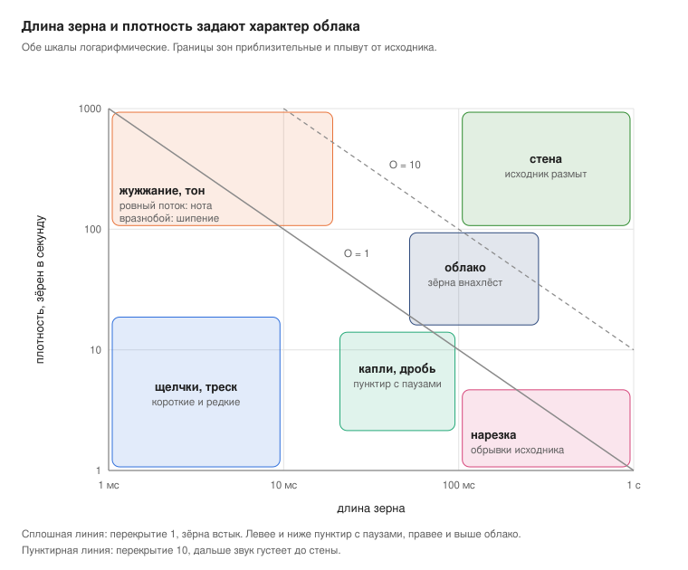

# Глава 13. Карта звука и двадцать инструментов из одной ложки

В начале книги было обещание: из трёх секунд звона ложки вырастет двадцать непохожих инструментов. Пора его выполнить. Сначала карта, по которой видно всё пространство сразу.

## Карта звука

Две ручки решают характер гранулярного звука сильнее всех остальных: длина зерна и плотность. Отложи их по осям, и пространство разложится на зоны.

<figure markdown="span">
  
  <figcaption>Карта звука: длина зерна и плотность.</figcaption>
</figure>

Линии на карте — это перекрытие из [главы 2](../chast-1-zerno/02-anatomiya-zerna.md), O = длина × плотность. Всё, что левее и ниже сплошной линии, звучит пунктиром: зёрна идут с паузами. Всё, что правее и выше, сливается в облако, а за пунктирной линией облако густеет в стену. Зона тона в левом верхнем углу живёт по правилам [главы 6](../chast-2-parametry/06-plotnost-i-sinkhronnost.md): ровный поток коротких зёрен даёт ноту, неровный даёт шипение.

Как пользоваться картой. Начни из середины облака: зерно около 100 мс, 30 зёрен в секунду. Это безопасная точка, где почти любой исходник звучит красиво. Дальше двигай одну ручку и следи, в какую зону ушёл. Остальные ручки (позиция, высота, разбросы, окно) меняют окраску внутри зоны, но редко выводят из неё.

## Двадцать инструментов

<figure markdown="span">
  
  <figcaption>Иллюстрация 13.1. Одна ложка, двадцать инструментов.</figcaption>
</figure>

Везде исходник один: ложка о чашку. Параметры даны в терминах [части 2](../chast-2-parametry/index.md), справа указано, где этот звук собирается проще всего и в каком рецепте он уже разобран.

| № | Звук | Как получить | Где проще |
| --- | --- | --- | --- |
| 1 | Ледяной пэд | позиция в звон, зерно 100–150 мс, облако, окно-колокол, немного разброса позиции и высоты, медленный скан | везде: рецепты 10.1, 11.1, 12.1 |
| 2 | Вечный звон | скан на нуле, разброс позиции 10–30 мс, зерно 80–150 мс | везде: заморозка из главы 4 |
| 3 | Удар длиной в минуту | позиция в начало, скан около 5% от исходной скорости, зерно 80 мс | везде, шкалу скана сверь по главе своего инструмента |
| 4 | Мерцающий орган | облако плюс голоса на октавах и квинтах | Serum: STACK 12+7, рецепт 10.5 |
| 5 | Аккорд одной клавишей | облако плюс юнисон, квантованный в аккорд | Pigments: режим Chord |
| 6 | Хор | асинхронное облако, разброс высоты 10–30 центов, широкое стерео | Granulator III, Cloud: рецепт 11.4 |
| 7 | Ложка-синтезатор | короткое зерно в ровном потоке, нота из частоты зёрен | Granulator III: рецепт 11.2; Serum: DENS в режиме Free |
| 8 | Колокол собора | высота −24 полутона, длинные зёрна, длинный реверб | везде |
| 9 | Стеклянная пыль | высота +24 полутона, зерно 10–20 мс, сильный разброс позиции и громкости | везде |
| 10 | Металлическое облако | облако плюс частотная модуляция от второго генератора | Serum: Warp FM, рецепт 10.4; Pigments: Freq Mod |
| 11 | Колокола из резонатора | облако через резонатор с негармоническим строем | Pigments: Resonator, рецепт 12.3 |
| 12 | Капли | зерно 20–40 мс, 3–6 зёрен в секунду, перкуссионное окно, разброс позиции на весь звон | везде: рецепты 10.2, 12.2 |
| 13 | Хэт из стука | позиция на атаку, зерно 5–15 мс, плотность по темпу 1/16, перкуссионное окно, фильтр снизу | Serum, Pigments: плотность по темпу |
| 14 | Нарезка в сетку | проход сэмпла привязан к такту, плотность 1/16, длина зерна в доле периода | Serum: рецепт 10.3; Pigments: Time Division |
| 15 | Всасывающий ритм | нарезка из пункта 14 плюс обратные зёрна по команде | Serum: Reverse Grains; Granulator III: Reverse в Loop |
| 16 | Квакающая сетка | своя огибающая фильтра на каждом зерне | Pigments: рецепт 12.5 |
| 17 | Бас | позиция в звон, высота −24…−36 полутонов, длинное зерно, моно, глайд, фильтр сверху | Granulator III: моно и Glide; везде |
| 18 | Райзер | за 4–8 тактов плотность растёт, зерно мельчает, высота и фильтр поднимаются | везде, одним макросом |
| 19 | Кухня | облако зёрен из шести разных записей | Pigments: Map Random, рецепт 12.4 |
| 20 | Живая петля | стучишь ложкой в микрофон прямо во время игры и захватываешь звук на лету | Granulator III: Capture, упражнение 11.1 |

Двадцать звуков из одного файла, и это далеко не предел: каждая строка таблицы сама по себе отправная точка для десятка вариантов.

## Упражнение 13.1. Свой пак { .exercise }

1. Собери все двадцать звуков. Каждый запиши по восемь тактов в аудио.
2. Подпиши файлы по таблице: «01 ледяной пэд», «02 вечный звон» и так далее.
3. Возьми другой исходник (свой голос, скрип двери, шум улицы) и пройди таблицу ещё раз.
4. Сравни два пака. Строки, где исходник поменял звук сильнее всего, подскажут, какие ручки сильнее зависят от материала.

*Иллюстрация 13.1. Одна ложка, двадцать инструментов.*
